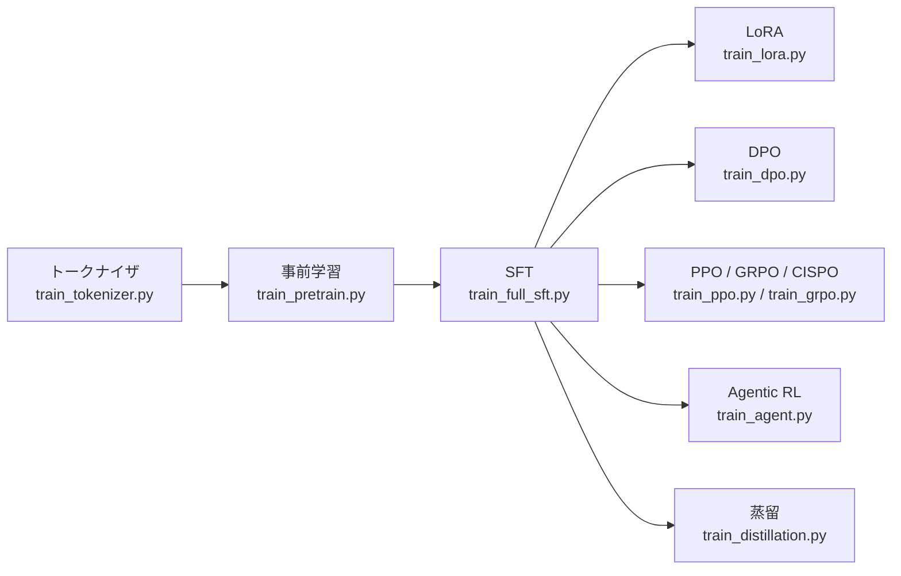
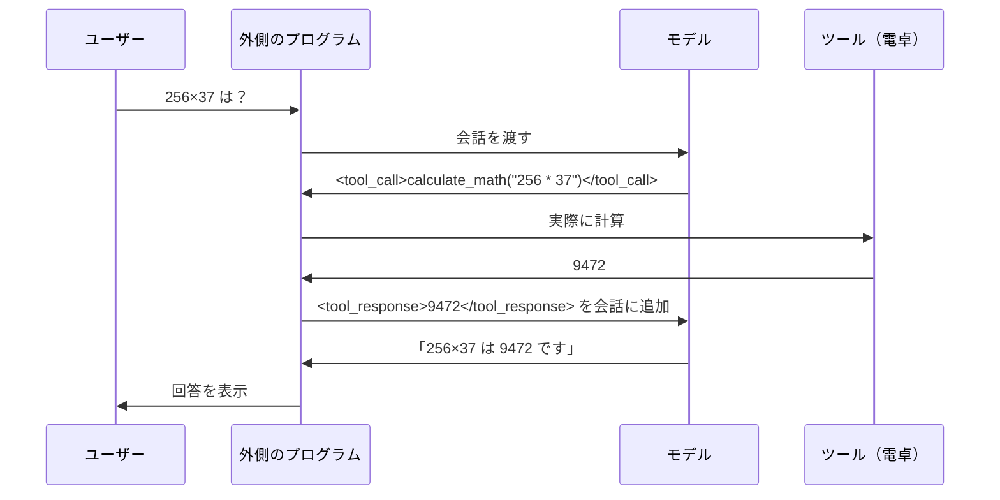

<div align="center">


# MiniMind 日本語ハンズオンガイド

**64M パラメータの LLM を、ゼロから自分の GPU で育てる**

[中文](./README.md) | [English](./README_en.md) | 日本語ハンズオン

</div>

---

## このガイドについて

このガイドは、本リポジトリの README をベースに、**実際に手を動かしながら LLM の仕組みを理解する**ことを目的に再構成した日本語版です。

- 各ステップで **「コードの中で何が起きているか」** を、実装の該当箇所と対応づけて解説します
- 背景技術は **身近なたとえ → 仕組み → 数式（任意）** の順で説明します
- 数式が出てきたら、すぐ後に **「式の読み方」** として日本語で言い直しています
- 必要な数学は [3 章の数学ミニ講座](#3-数学ミニ講座-これだけ分かれば読める) にまとめました。高校数学を忘れていても大丈夫です
- 個人の GPU（例：RTX 3070 / 8GB）で動かすときの実用的な注意点も載せています

対象読者は「Python と PyTorch の基本は分かるが、LLM を自分で学習させたことはない」人です。

**このガイドの読み方**

- 💡 **ひとことで言うと** … その技術の要点を 1〜2 文で
- 📐 **式の読み方** … 数式を日本語に翻訳したもの
- 🔍 **もう少し詳しく** … 読み飛ばしても手順は進められる発展的な内容

> [!NOTE]
> README の記述（学習コスト・評価結果など）は原著者の環境（RTX 3090）での値です。本ガイド内で「実測」と書いた数値は、RTX 3070 (8GB) + PyTorch 2.14 + CUDA 13 環境で確認したものです。

### 目次

- [0. 全体像 LLM はどう作られるのか](#0-全体像-llm-はどう作られるのか)
- [1. 環境構築](#1-環境構築)
- [2. まず動かす 学習済みモデルで推論](#2-まず動かす-学習済みモデルで推論)
- [3. 数学ミニ講座 これだけ分かれば読める](#3-数学ミニ講座-これだけ分かれば読める)
- [4. MiniMind の中身を読む](#4-minimind-の中身を読む)
- [5. データの準備](#5-データの準備)
- [6. ハンズオン1 事前学習 (Pretrain)](#6-ハンズオン1-事前学習-pretrain)
- [7. ハンズオン2 教師ありファインチューニング (SFT)](#7-ハンズオン2-教師ありファインチューニング-sft)
- [8. ハンズオン3 LoRA で独自データに適応させる](#8-ハンズオン3-lora-で独自データに適応させる)
- [9. Tool Calling と Adaptive Thinking](#9-tool-calling-と-adaptive-thinking)
- [10. 強化学習 モデルに試行錯誤させる](#10-強化学習-モデルに試行錯誤させる)
- [11. 知識蒸留](#11-知識蒸留)
- [12. 長文対応 YaRN による RoPE の拡張](#12-長文対応-yarn-による-rope-の拡張)
- [13. モデルの変換とサービング](#13-モデルの変換とサービング)
- [14. トラブルシューティング](#14-トラブルシューティング)
- [15. 用語集](#15-用語集)
- [16. 次のステップと参考文献](#16-次のステップと参考文献)

---

## 0. 全体像 LLM はどう作られるのか

> 💡 **ひとことで言うと**
> LLM は「大量の文章を読ませて次の単語を当てる練習をさせる」→「会話の型を教える」→「良い答え方を褒めて伸ばす」という 3 段階で作られます。

人間の新入社員にたとえると分かりやすいです。

| 段階 | たとえ | 何を学ぶか | 出力される重み |
|---|---|---|---|
| 事前学習 | 図書館の本を片っ端から読む | 言葉の使い方・世界の知識 | `out/pretrain_768.pth` |
| SFT | 接客マニュアルで研修 | 質問に答える「型」 | `out/full_sft_768.pth` |
| LoRA | 専門分野の短期講習 | 特定の分野・キャラ付け | `out/lora_xxx_768.pth` |
| DPO | 「こっちの対応の方が良い」と比較で指導 | 好ましい答え方 | `out/dpo_768.pth` |
| PPO/GRPO | 実際にやらせて点数をつけ、改善させる | 点数が高くなる答え方 | `out/ppo_actor_768.pth` / `grpo_768.pth` |
| Agentic RL | 道具（電卓など）を使う実地訓練 | 複数ステップの道具の使い方 | `out/agent_768.pth` |

MiniMind はこのパイプラインを **すべて素の PyTorch で** 実装しており、各段階のスクリプトが `trainer/` に揃っています。



**最短ルート**は「事前学習 → SFT」の 2 段階です。README によれば RTX 3090 1 枚で約 2 時間、mini データセットで会話できるモデル（MiniMind Zero）が得られます。

---

## 1. 環境構築

### 1.1 推奨構成

| 項目 | 推奨 |
|---|---|
| OS | Linux（WSL2 でも可） |
| Python | 3.10 系（README の動作確認は 3.10.16） |
| GPU | NVIDIA GPU（VRAM 8GB 以上あると快適）。CPU / Apple MPS でも動くが非常に遅い |
| ディスク | mini データセットだけで約 3GB、フルデータなら 25GB 以上 |

> 🔍 **なぜ GPU が必要なのか**
> LLM の計算はほとんどが「大量の掛け算と足し算」です。CPU は少数の賢い職人、GPU は単純作業を同時にこなす数千人の作業員のようなもので、同じ形の計算を一斉に処理するのが得意です。**VRAM** は GPU 専用のメモリで、モデルや計算途中のデータがここに収まらないと学習できません。

### 1.2 mise + uv で仮想環境を作る（このリポジトリの推奨手順）

リポジトリ直下の [mise.toml](mise.toml) で Python 3.10 と uv を固定し、`.venv` を自動作成するようにしています。

```bash
# mise のインストール（未導入の場合）
curl https://mise.run | sh
echo 'eval "$(~/.local/bin/mise activate bash)"' >> ~/.bashrc
source ~/.bashrc

# リポジトリに入ると .venv が自動作成・有効化される
cd minimind
mise trust && mise install

# 依存パッケージのインストール
uv pip install -r requirements.txt
```

`requirements.txt` では torch がコメントアウトされていますが、依存関係（`sentence_transformers` など）経由で PyPI の最新 torch が入ります。特定のバージョンや CUDA 版を使いたい場合は先に明示的に入れておきます。

```bash
# 例：README 想定に近い torch 2.6 + CUDA 12.4
UV_HTTP_TIMEOUT=300 uv pip install torch==2.6.0 torchvision==0.21.0 \
  --index-url https://download.pytorch.org/whl/cu124
```

> [!TIP]
> PyTorch の CUDA 版 wheel は数 GB あり、ダウンロードがタイムアウトしやすいです。`UV_HTTP_TIMEOUT` を延ばすと安定します。

### 1.3 動作確認

```bash
python -c "import torch; print(torch.__version__, torch.cuda.is_available(), torch.cuda.get_device_name())"
```

`True` と GPU 名が出れば OK です。さらに、リポジトリのモデル定義が GPU 上で動くかを確かめておきましょう。

```bash
python - <<'EOF'
import torch
from transformers import AutoTokenizer
from model.model_minimind import MiniMindConfig, MiniMindForCausalLM
tok = AutoTokenizer.from_pretrained('model')
m = MiniMindForCausalLM(MiniMindConfig()).cuda()
x = tok('你好，世界', return_tensors='pt').input_ids.cuda()
out = m(x, labels=x)
print('loss', out.loss.item(), 'params(M)', sum(p.numel() for p in m.parameters()) / 1e6)
EOF
```

実測では `loss 8.84 params(M) 63.91` と出力されました。「params 63.91M」は **モデルの中に約 6,391 万個の調整可能な数値がある** という意味です。**なぜ学習前の loss が約 8.8 なのか**は [6.4 節](#64-ログの読み方) で解説します。

---

## 2. まず動かす 学習済みモデルで推論

学習の前に、完成品がどんなものかを触っておくとゴールが見えます。「**推論**」とは、学習済みのモデルに入力を与えて出力を得ること、つまりモデルを「使う」ことです。

### 2.1 モデルのダウンロード

```bash
# リポジトリ直下で
modelscope download --model gongjy/minimind-3 --local_dir ./minimind-3
# または Hugging Face から
git clone https://huggingface.co/jingyaogong/minimind-3
```

### 2.2 CLI で対話

```bash
# Transformers 形式のモデルを使う
python eval_llm.py --load_from ./minimind-3

# 自分で学習した PyTorch 重み（./out/full_sft_768.pth）を使う
python eval_llm.py --load_from ./model --weight full_sft
```

起動するとテスト用プロンプトの自動実行か、手動入力かを選べます。主なオプションは次の通りです。

| オプション | 既定値 | 意味 |
|---|---|---|
| `--weight` | `full_sft` | `out/` 内の重みの接頭辞（`pretrain`, `dpo`, `grpo`, `agent` など） |
| `--lora_weight` | `None` | 重ねる LoRA 重みの名前（例：`lora_medical`） |
| `--temperature` | `0.85` | 出力の冒険度。下げるほど無難で決まりきった答えに（[4.9 節](#49-文章の生成-サンプリングと-kv-キャッシュ)） |
| `--top_p` | `0.95` | 候補の絞り込み度合い |
| `--open_thinking` | `0` | `1` で `<think>` による思考過程を出力 |
| `--historys` | `0` | 会話履歴として持ち越すターン数 |
| `--inference_rope_scaling` | off | 長い文章への対応を有効化（[12 章](#12-長文対応-yarn-による-rope-の拡張)） |

> [!IMPORTANT]
> MiniMind の学習データは**主に中国語と英語**です。日本語で質問しても期待通りに答えないことが多いので、まずは中国語か英語で試してください（理由は [4.2 節](#42-トークナイザ-文章を数字の列に変える) を参照）。

### 2.3 WebUI（任意）

```bash
cp -r minimind-3 ./scripts/minimind-3   # web_demo はここをスキャンする
cd scripts && streamlit run web_demo.py
```

思考過程の表示、ツール選択、複数ターンの Tool Call を GUI で試せます。

### 2.4 Ollama / vLLM（任意）

```bash
ollama run jingyaogong/minimind-3
vllm serve ./minimind-3 --model-impl transformers --served-model-name "minimind"
```

---

## 3. 数学ミニ講座 これだけ分かれば読める

この章では、後の解説で出てくる数学の道具を、**具体的な数値例つき** でまとめます。どれも「計算できる」必要はなく、「何をしているのか」のイメージがつかめれば十分です。必要になったときに戻ってくる辞書として使ってもかまいません。

### 3.1 ベクトル 意味を表す数の並び

**ベクトル**は、単に「数を一列に並べたもの」です。

```
「犬」 = [0.9, 0.8, 0.1]
「猫」 = [0.8, 0.9, 0.2]
「車」 = [0.1, 0.2, 0.9]
```

仮に 1 つ目の数を「動物っぽさ」、2 つ目を「ペットっぽさ」、3 つ目を「機械っぽさ」とすると、犬と猫の数が似ていて、車だけ違うのが分かります。このように **単語を「意味の空間」の中の点（座標）として表す** のが LLM の基本的な考え方です。

MiniMind では 1 つのトークンを **768 個の数** で表します（`hidden_size=768`）。実際の 768 個の数それぞれが何を意味するかは人間が決めるのではなく、学習によって自動的に決まります。

**次元**という言葉は「数がいくつ並んでいるか」を指します。「768 次元のベクトル」= 768 個の数の並び、です。

### 3.2 内積 2つのベクトルがどれくらい似ているか

**内積**は、2 つのベクトルの同じ位置の数どうしを掛けて、全部足したものです。

```
犬・猫 = 0.9×0.8 + 0.8×0.9 + 0.1×0.2 = 0.72 + 0.72 + 0.02 = 1.46   ← 大きい（似ている）
犬・車 = 0.9×0.1 + 0.8×0.2 + 0.1×0.9 = 0.09 + 0.16 + 0.09 = 0.34   ← 小さい（似ていない）
```

向きが似ているベクトルほど内積は大きくなります。**Attention（4.5 節）は、この内積で「どの単語に注目すべきか」を決めています。**

### 3.3 行列と線形層 ベクトルを別のベクトルに変換する

**行列**は数を縦横の表にしたものです。行列をベクトルに掛けると、**別のベクトルに変換** できます。

```
     行列 W (2×3)          ベクトル x (3)     結果 y (2)
  [ 1  0  1 ]             [ 0.9 ]          [ 0.9×1 + 0.8×0 + 0.1×1 ] = [ 1.0 ]
  [ 0  2  0 ]       ×     [ 0.8 ]    =     [ 0.9×0 + 0.8×2 + 0.1×0 ]   [ 1.6 ]
                          [ 0.1 ]
```

結果の各要素は「W の各行と x の内積」です。PyTorch の `nn.Linear(768, 384)` は、**768 次元のベクトルを 384 次元のベクトルに変換する行列** を 1 つ持っている部品で、これを **線形層** と呼びます。

ニューラルネットワークの「**パラメータ**（重み）」とは、主にこの行列の中の数のことです。**学習とは、この数たちを少しずつ調整して、望む出力が出るようにすること** です。

> 🔍 **テンソルの形の読み方**
> コード中の `[B, T, D]` のような表記は、データの形（各方向の要素数）を表します。
> - `B`（Batch）：同時に処理する文章の数
> - `T`（Time / 長さ）：1 つの文章のトークン数
> - `D`（次元）：1 トークンを表すベクトルの長さ（768）
>
> つまり `[32, 340, 768]` は「32 本の文章 × 各 340 トークン × 各トークン 768 個の数」です。

### 3.4 確率分布と softmax 点数を確率に変える

**確率分布**とは「起こりうることそれぞれに確率を割り振ったもので、合計が 1（100%）になるもの」です。サイコロなら 6 つの目に 1/6 ずつ、という分布です。

LLM は次のトークンについて、語彙 6,400 種類それぞれに **点数（logits と呼ぶ）** を出します。この点数はマイナスもあり、合計も 1 になりません。これを確率に変換するのが **softmax** です。

$$
\mathrm{softmax}(z_i) = \frac{e^{z_i}}{\sum_j e^{z_j}}
$$

📐 **式の読み方**：「各点数を $e$（約 2.718）の肩に乗せて全部プラスの数にし、合計で割って合計を 1 にする」。

```
点数 (logits)      [ 2.0,  1.0,  0.0 ]
e の累乗            [ 7.39, 2.72, 1.00 ]   合計 11.11
softmax（確率）     [ 0.665, 0.245, 0.090 ]  ← 合計 1.0
```

点数の大小関係は保ったまま、差が強調されます（点数 2 と 1 の差が、確率では 66.5% と 24.5% に広がる）。

### 3.5 対数 log 掛け算を足し算に、小さな数を扱いやすく

**対数** $\log x$（このガイドでは自然対数 $\ln$）は「$e$ を何乗すると $x$ になるか」です。覚えておくと便利な性質は次の 3 つです。

- $\log(a \times b) = \log a + \log b$（**掛け算が足し算になる**）
- $\log 1 = 0$、1 より小さい数の log はマイナス
- 確率が 0 に近づくほど $-\log p$ は大きくなる

| 確率 $p$ | $-\log p$ |
|---|---|
| 0.9 | 0.105 |
| 0.5 | 0.693 |
| 0.1 | 2.303 |
| 0.01 | 4.605 |

文章全体の確率は各トークンの確率の掛け算になり、すぐに 0.0000…01 のような極小の数になってコンピュータで扱えなくなります。log を取れば足し算になり、数も扱いやすい大きさになるので、LLM の計算では確率の代わりに **対数確率（log probability, logp）** がよく使われます。

### 3.6 交差エントロピー 予想がどれだけ外れたかの点数

LLM の学習で最小化する **損失（loss）** は **交差エントロピー** です。難しそうな名前ですが、中身はシンプルです。

$$
\mathcal{L} = -\log p(\text{正解})
$$

📐 **式の読み方**：「モデルが **正解のトークンにつけた確率** の $-\log$」。上の表のとおり、

- 正解に 90% の確率をつけていた → loss 0.105（ほぼ満点）
- 正解に 1% しかつけていなかった → loss 4.605（大外れ）

テストにたとえると、**「正解にどれだけ自信を持って賭けていたか」で採点する** 方式です。自信満々で外すと大きく減点されます。実際の loss は、全トークンについてこれを平均した値です。

> 🔍 **パープレキシティ（PPL）**
> $e^{\text{loss}}$ を **パープレキシティ** と呼び、「モデルが平均して何択で迷っているか」の目安になります。loss 3.0 なら $e^3 \approx 20$ 択、loss 2.0 なら約 7.4 択まで絞り込めている、という意味です。

### 3.7 勾配と勾配降下法 霧の中で山を下る

学習では、loss が小さくなるようにパラメータを調整します。でも 6,000 万個のパラメータを、どちらにどれだけ動かせばいいのでしょうか。

**たとえ**：濃い霧の中、山の谷底（loss 最小の地点）を目指して歩いています。遠くは見えませんが、**足元の傾き** は分かります。だから「下り坂の方向に少し進む」を何万回も繰り返せば、いずれ谷底に近づけます。

- **勾配（gradient）**：各パラメータを少し増やしたとき、loss がどれだけ増えるか（＝足元の傾き）
- **勾配降下法**：勾配の逆方向（下り坂）にパラメータを少し動かす

$$
\theta \leftarrow \theta - \eta \cdot \nabla \mathcal{L}
$$

📐 **式の読み方**：「パラメータ $\theta$ を、勾配 $\nabla \mathcal{L}$ の逆向きに、学習率 $\eta$ の分だけ動かす」。

- **学習率（learning rate）**：一歩の歩幅。大きすぎると谷を飛び越えて暴れ、小さすぎるといつまでも着かない
- **誤差逆伝播（backpropagation）**：6,000 万個すべての勾配を効率よく計算する方法。出力側から入力側へ「この誤差に対して、あなたはどれだけ責任がありますか」を順に割り振っていくイメージ。PyTorch では `loss.backward()` の 1 行で自動計算されます

### 3.8 期待値 E 平均のこと

数式に出てくる $\mathbb{E}[\cdots]$ は **期待値**、つまり「たくさん試したときの平均」です。$\mathbb{E}_{q \sim P(Q)}[\cdots]$ のように下に書いてあるのは「何について平均を取るか」で、この例なら「データセットから質問 $q$ をいろいろ取ってきて平均する」という意味です。実装上はほぼ「バッチ内の平均（`.mean()`）」と読み替えて大丈夫です。

### 3.9 平均と標準偏差 偏差値と同じ考え方

**標準偏差** $\sigma$ は「データが平均からどれくらいばらついているか」です。日本の学校でおなじみの **偏差値** は、

$$
\text{偏差値} = 50 + 10 \times \frac{\text{点数} - \text{平均}}{\text{標準偏差}}
$$

でした。この $\frac{x - \mu}{\sigma}$ の部分（**標準化**）が、**GRPO（10.6 節）でそのまま使われています**。「その答えが、同じ問題への他の答えと比べてどれだけ良かったか」を偏差値のように測るのです。

### 3.10 シグモイド関数 何でも 0 から 1 に押し込む

$$
\sigma(x) = \frac{1}{1 + e^{-x}}
$$

どんな数を入れても 0〜1 の間に収まる関数です。$\sigma(-2) = 0.12$、$\sigma(0) = 0.5$、$\sigma(2) = 0.88$。「確率っぽい値」に変換したいときに使います。DPO（10.3 節）や SwiGLU（4.7 節）に登場します。

### 3.11 KL ダイバージェンス 2つの確率分布のズレ

**KL ダイバージェンス** は「2 つの確率分布がどれくらい違うか」を測る量です。完全に同じなら 0、違うほど大きくなります。

```
分布 P（元のモデル）:      [0.7, 0.2, 0.1]
分布 Q（学習後のモデル）:  [0.4, 0.3, 0.3]
KL(P‖Q) ≈ 0.20
```

強化学習では「学習中のモデルが元のモデルからどれだけ変わってしまったか」を測る **命綱** として使われます（10.1 節）。

### 3.12 正規化 大きさを揃える

**正規化（normalization）** は、数の大きさ（スケール）を一定の範囲に揃える操作です。**たとえ**：会議で声の大きい人と小さい人がいると、内容ではなく声量で議論が左右されてしまいます。全員の音量を揃えてから聞けば、内容で判断できます。ニューラルネットワークでも、層を重ねるうちに数がどんどん大きく（または小さく）なって計算が不安定になるのを、正規化で防ぎます。

---

## 4. MiniMind の中身を読む

ここからは「なぜこの構造なのか」を、実際のコード [model/model_minimind.py](model/model_minimind.py) と対応させながら見ていきます。このファイルは 300 行足らずで、現代的な LLM（Qwen3 系）の構成要素がほぼすべて入っています。

### 4.1 言語モデルの基本 次のトークンを当てる

> 💡 **ひとことで言うと**
> LLM がやっていることは「ここまでの文章を見て、次に来るトークンを確率で予想する」ことだけです。これを繰り返すと文章が書けます。

スマートフォンの **予測変換** を、とてつもなく賢くしたものだと考えてください。「今日は天気が」と入力すると「いい」「悪い」「良く」などが候補に出ますね。LLM は語彙 6,400 種類すべてに確率をつけ、そこから 1 つ選んで文章に追加し、また次を予想する、を繰り返します。

$$
P(x_t \mid x_1, x_2, \dots, x_{t-1})
$$

📐 **式の読み方**：「1 番目から $t-1$ 番目までのトークンが与えられたとき（`|` の右側が条件）に、$t$ 番目のトークンが $x_t$ である確率」。

学習では、正解のトークンに高い確率をつけられるように、[交差エントロピー](#36-交差エントロピー-予想がどれだけ外れたかの点数) を小さくします。MiniMind の実装では、入力と正解を 1 つずらして計算しています。

```python
# model/model_minimind.py: MiniMindForCausalLM.forward
x, y = logits[..., :-1, :].contiguous(), labels[..., 1:].contiguous()
loss = F.cross_entropy(x.view(-1, x.size(-1)), y.view(-1), ignore_index=-100)
```

この「ずらし」は次のような対応を作っています。

```
入力:  白   日   依   山
正解:  日   依   山   尽     ← 各位置で「次の文字」を当てる
```

1 つの文章から、すべての位置で同時に「次を当てる問題」を作れるのが、この学習方法の効率の良さです。`ignore_index=-100` は「**この位置は採点しない**」という印で、パディング（長さ合わせの詰め物）や SFT での質問部分に使います（[7.3 節](#73-loss-mask-回答部分だけを採点する)）。

### 4.2 トークナイザ 文章を数字の列に変える

> 💡 **ひとことで言うと**
> トークナイザは、文章をモデルが扱える「部品（トークン）の番号の列」に変換する辞書です。よく一緒に出てくる文字の組み合わせを 1 つの部品にまとめています。

モデルは数字しか扱えないので、文章を **トークン ID** の列に変換します。

```
"白日依山尽"  →  ["白", "日", "依", "山", "尽"]  →  [1234, 567, 2890, 431, 3021]  (ID は例)
```

**BPE (Byte Pair Encoding) の考え方**

1 文字ずつ区切ると列が長くなりすぎ、単語ごとに区切ると辞書が膨大になります。BPE はその中間をとる方法です。

1. 最初はすべての「文字」（Byte-Level の場合はコンピュータ内部の **バイト**、256 種類）をバラバラの部品とする
2. 大量の文章の中で、**最もよく隣り合っている 2 つの部品** を合体させて新しい部品にする（例：`t` + `h` → `th`、`th` + `e` → `the`）
3. 辞書が目標サイズになるまで 2 を繰り返す

> 🔍 **バイトとは**
> コンピュータは文字を UTF-8 という方式で 1〜4 個の「バイト」（0〜255 の数）として保存しています。英字は 1 文字 1 バイト、日本語のかなや漢字は 1 文字 3 バイトです。Byte-Level BPE はこのバイトから出発するので、**どんな文字でも（辞書にない文字でも）必ずバイトの組み合わせとして表せる** のが利点です。

**MiniMind の語彙サイズは 6,400**

| トークナイザ | 語彙サイズ |
|---|---|
| Llama 3 | 128,000 |
| Qwen2 | 151,643 |
| Mistral | 32,000 |
| **MiniMind** | **6,400** |

辞書を小さくしているのは、**辞書の単語数 × 768 個の数** がそのまま埋め込み層（4.3 節）のパラメータになるからです。Qwen2 の辞書を MiniMind に使うと、それだけで約 1 億 1,600 万パラメータになり、モデル本体（約 5,900 万）より大きくなってしまいます。6,400 語なら約 490 万で済みます。

**日本語との相性（実測）**

辞書の大半は中国語と英語のよく出るパターンに割り当てられているため、日本語のかなは合体の対象になりにくく、**バイトのまま** バラバラに分割されがちです。

```python
from transformers import AutoTokenizer
tok = AutoTokenizer.from_pretrained('model')
for s in ['白日依山尽', 'The sun sets in the west', '吾輩は猫である。名前はまだ無い。']:
    ids = tok(s, add_special_tokens=False).input_ids
    print(len(s), '文字 ->', len(ids), 'トークン', [tok.decode([i]) for i in ids][:10])
```

| 入力 | 文字数 | トークン数 | 備考 |
|---|---|---|---|
| `白日依山尽` | 5 | 5 | 漢字は 1 文字 1 トークン |
| `The sun sets in the west` | 24 | 8 | 英語は単語単位でまとまる |
| `吾輩は猫である。名前はまだ無い。` | 16 | 22 | かなの一部が生のバイト（`�` と表示）に分解される |

つまり日本語は **同じ文章量でもトークン数が多くなり**、学習データにもほとんど含まれていません。日本語対応を本格的にやるなら、トークナイザの再学習（`trainer/train_tokenizer.py`）と日本語の文章での事前学習が必要です。ただしトークナイザを変えると既存の重み・データとの互換性がすべて失われる点に注意してください。

**特殊トークン**（文章の区切りなどを表す、特別な意味を持つトークン）

| トークン | 役割 |
|---|---|
| `<\|im_start\|>` | BOS（Beginning of Sequence）：発話の開始 |
| `<\|im_end\|>` | EOS（End of Sequence）：発話の終了。これが出たら生成を止める |
| `<\|endoftext\|>` | PAD：長さを揃えるための詰め物 |
| `<think>` `</think>` | 思考過程の区切り |
| `<tool_call>` `<tool_response>` | ツール呼び出しの区切り |

### 4.3 モデル全体の構造


> 💡 **ひとことで言うと**
> トークンをベクトルに変え、「周りを見て文脈を取り込む（Attention）」と「知識を引いて加工する（FFN）」を 8 回繰り返し、最後に次のトークンの点数を出します。

MiniMind-3 は **Decoder-Only Transformer** という、GPT や Llama と同じ種類の構造です。処理の流れは次の通りです。

```
トークン ID の列 [B, T]
  → embed_tokens   各トークンを 768 次元のベクトルに変換（辞書引き）
  → ブロック × 8    Attention + FFN を 8 回繰り返して文脈を深く理解する
  → norm           大きさを整える
  → lm_head        768 次元 → 6,400 個の点数（logits）に変換
```

**埋め込み（Embedding）**：トークン ID を [3.1 節](#31-ベクトル-意味を表す数の並び) で見た「意味のベクトル」に変換する、6,400 行 × 768 列の巨大な表です。ID が 1234 なら 1234 行目を取り出すだけ、という単純な仕組みです。

**ブロックの中身：Pre-Norm + 残差接続**

```python
# model/model_minimind.py: MiniMindBlock.forward
residual = hidden_states
hidden_states, present_key_value = self.self_attn(self.input_layernorm(hidden_states), ...)
hidden_states += residual
hidden_states = hidden_states + self.mlp(self.post_attention_layernorm(hidden_states))
```

- **残差接続（residual connection）**：`x + f(x)` のように、**加工結果に元の入力を足し戻す** 仕組みです。**たとえ**：伝言ゲームで、各人が「自分の補足」だけを書き足し、元のメッセージも一緒に回していく方式。8 段階を経ても元の情報が失われず、学習時の勾配も入力側まで届きやすくなります
- **Pre-Norm**：各部品（Attention, FFN）に入る **前に** [正規化](#312-正規化-大きさを揃える) をかける配置。元祖 Transformer は後にかけていましたが、前にかける方が学習が安定することが分かり、現在の LLM ではほぼ標準です

**パラメータ数の内訳（`hidden_size=768`, 8 層）**

| 部位 | 行列の形 | パラメータ数 |
|---|---|---|
| 埋め込み（`lm_head` と共有） | 6400 × 768 | 4.92M |
| Attention: q_proj / o_proj | 768 × 768 ×2 | 1.18M / 層 |
| Attention: k_proj / v_proj | 768 × 384 ×2 | 0.59M / 層 |
| FFN: gate / up / down | 768 × 2432 ×3 | 5.60M / 層 |
| **1 層合計** | | **約 7.37M** |
| **全体** | 4.92M + 7.37M × 8 | **約 63.9M** |

（M = 百万）パラメータの大半は FFN が占めていることが分かります。

**重み共有（Weight Tying）**：入口の埋め込み（ID → ベクトル）と出口の `lm_head`（ベクトル → 各トークンの点数）は逆向きの操作なので、同じ表を使い回しています（`tie_word_embeddings=True`）。小さなモデルでは約 490 万パラメータの節約になります。

### 4.4 RMSNorm 大きさを揃える部品

> 💡 **ひとことで言うと**
> ベクトルの数値の「平均的な大きさ」で割って、だいたい 1 前後に揃える部品です。

$$
\mathrm{RMSNorm}(x) = \frac{x}{\sqrt{\frac{1}{d}\sum_i x_i^2 + \epsilon}} \odot g
$$

📐 **式の読み方**：「ベクトルの各要素を 2 乗して平均し、そのルート（RMS = 二乗平均平方根、"平均的な大きさ"）で全体を割る。最後に、学習で調整される倍率 $g$ を要素ごとに掛ける（$\odot$ は要素ごとの掛け算）」。$\epsilon$ は 0 で割るのを防ぐための極小の数です。

```python
def norm(self, x):
    return x * torch.rsqrt(x.pow(2).mean(-1, keepdim=True) + self.eps)  # rsqrt = 1/√
```

以前よく使われた LayerNorm は「平均を引いてからばらつきで割る」でしたが、RMSNorm は平均を引く手順を省いて計算を軽くしたものです。性能はほぼ変わらないため、Llama 以降の LLM で広く使われています。

### 4.5 Self-Attention 文脈の中で誰に注目するか

> 💡 **ひとことで言うと**
> 各トークンが「自分の意味を決めるために、文中のどのトークンをどれだけ参考にすべきか」を計算し、参考にすべき相手の情報を集めてくる仕組みです。

**なぜ必要か**：「銀行の **口座** を開いた」と「川の **岸** に座った」のように、単語の意味は周りの単語で決まります。英語の "bank" なら、周囲に "money" があるか "river" があるかで意味が変わります。Attention は、この「周りを見て意味を決める」を行う部品です。

**たとえ：図書館での調べもの**

| 役割 | たとえ | 中身 |
|---|---|---|
| **Query（Q）** | 自分が調べたいこと（検索ワード） | 「私はどんな情報を探しているか」 |
| **Key（K）** | 各本の背表紙・索引 | 「私はこんな情報を持っています」 |
| **Value（V）** | 本の中身 | 実際に渡す情報 |

各トークンは自分の Query を、全トークンの Key と [内積](#32-内積-2つのベクトルがどれくらい似ているか) で照合し、よく一致した相手の Value を多めに集めてきます。

$$
\mathrm{Attention}(Q, K, V) = \mathrm{softmax}\left(\frac{QK^\top}{\sqrt{d_k}} + M\right)V
$$

📐 **式の読み方**：

1. $QK^\top$：自分の Query と全員の Key の内積 ＝「各トークンとの相性の点数」
2. $\sqrt{d_k}$ で割る：ベクトルが長い（$d_k$=96 次元）と内積が大きくなりすぎるので、ほどよい大きさに縮める
3. $+M$：未来のトークンを見ないための目隠し（下で説明）
4. $\mathrm{softmax}$：点数を「注目する割合」（合計 100%）に変換
5. $\times V$：その割合で全員の Value を混ぜ合わせる

**因果マスク（causal mask）**：文章を生成するとき、まだ書いていない未来の単語は見えません。学習時も同じ条件にしないと、「答えを見ながら次の単語を当てる」カンニングになってしまいます。そこで、未来の位置の点数を $-\infty$（softmax 後に 0%）にして見えなくします。

```python
scores = (xq @ xk.transpose(-2, -1)).float() / math.sqrt(self.head_dim)
scores[:, :, :, -seq_len:] += torch.full((seq_len, seq_len), float("-inf")).triu(1)  # 未来を隠す
```

```
         白   日   依   山       ← 見られる側
白       ○    ×    ×    ×
日       ○    ○    ×    ×      ○ = 見てよい
依       ○    ○    ○    ×      × = 未来なので隠す
山       ○    ○    ○    ○
```

実際の計算では、PyTorch の `F.scaled_dot_product_attention`（FlashAttention 系の高速な計算方法）が使える場合はそちらが使われます。結果は同じで、メモリ効率が良くなります。

**Multi-Head Attention**：768 次元を 8 つの「ヘッド」（各 96 次元）に分け、それぞれが独立に Attention を計算します。**たとえ**：1 つの文章を 8 人の専門家が同時に読み、ある人は文法的なつながり、ある人は「それ」「これ」が何を指すか、ある人は話題のつながり…と、異なる観点で注目先を決めます。

**GQA (Grouped-Query Attention)**：MiniMind は Query のヘッドが 8 個に対し、Key/Value のヘッドは 4 個しかありません。**2 人の専門家が 1 組の資料（K/V）を共有して読む** 形です。

| 方式 | Q ヘッド | KV ヘッド | 特徴 |
|---|---|---|---|
| MHA | 8 | 8 | 全員が自分専用の資料。表現力は最大だがメモリを食う |
| **GQA** | **8** | **4** | **2 人で 1 組を共有。品質とメモリのバランスが良い** |
| MQA | 8 | 1 | 全員で 1 組を共有。メモリ最小だが品質が落ちやすい |

文章生成時には過去の K/V を保存しておく必要があり（[4.9 節の KV キャッシュ](#49-文章の生成-サンプリングと-kv-キャッシュ)）、GQA ならその保存量が半分で済みます。

**QK-Norm**：MiniMind は Q と K にも RMSNorm をかけています（`q_norm`, `k_norm`）。内積の点数が極端に大きくなって「1 つのトークンにだけ 100% 注目する」ような偏りが起きるのを防ぎ、学習を安定させます。Qwen3 などで採用された工夫です。

### 4.6 RoPE 回転で位置を表す

> 💡 **ひとことで言うと**
> トークンのベクトルを「文中の位置に応じた角度」だけ回転させることで、順番の情報を埋め込みます。回転の角度の **差** が、トークン同士の距離を表します。

**なぜ必要か**：Attention の計算（内積と足し算）には、実は「順番」の概念がありません。このままだと「猫が犬を追う」と「犬が猫を追う」を区別できません。そこで位置の情報を加える必要があります。

**たとえ：速さの違う時計の針**

時計には秒針・分針・時針があり、それぞれ違う速さで回ります。3 本の針の角度を見れば、正確な時刻が分かりますね。RoPE は、768 次元のベクトルを 2 個ずつのペアに分け、**各ペアを「速さの違う針」として、位置 $m$ に比例した角度だけ回転** させます。

```
位置 0:  針A ↑   針B ↑   針C ↑
位置 1:  針A ↗   針B ↑   針C ↑      針A（速い）は大きく回り、
位置 2:  針A →   針B ↗   針C ↑      針C（遅い）はほとんど回らない
...
```

- **速く回る針**：隣のトークンとの違いなど、近い距離を細かく区別するのに役立つ
- **ゆっくり回る針**：文章の前半か後半かなど、遠い距離を区別するのに役立つ

ここが巧妙なところで、回転させた 2 つのベクトルの内積は、**2 つの位置の角度の差＝相対的な距離** だけで決まります。「5 番目と 8 番目」も「100 番目と 103 番目」も、同じ「3 つ離れている」として扱われるのです。

$$
\theta_i = \text{base}^{-2i/d}, \quad \text{位置 } m \text{ の回転角} = m \cdot \theta_i
$$

📐 **式の読み方**：「$i$ 番目のペア（針）の回転の速さ $\theta_i$ は、$i$ が大きいほど遅くなる。位置 $m$ のトークンは、その速さ × $m$ だけ回転する」。`base`（`rope_theta`）は針の速さの範囲を決める定数で、MiniMind は $10^6$（100 万）です。大きいほど最も遅い針がさらに遅くなり、長い文章でも位置を区別しやすくなります。

```python
# 各ペアの回転の速さ
freqs = 1.0 / (rope_base ** (torch.arange(0, dim, 2)[: (dim // 2)].float() / dim))
# Q, K に回転を適用（cos/sin は回転を計算するための三角関数）
def rotate_half(x): return torch.cat((-x[..., x.shape[-1] // 2:], x[..., : x.shape[-1] // 2]), dim=-1)
q_embed = (q * cos) + (rotate_half(q) * sin)
```

学習時より長い文章に対応させる **YaRN** は、この「針の速さ」を調整する技術です（[12 章](#12-長文対応-yarn-による-rope-の拡張)）。

### 4.7 FFN と SwiGLU 知識の辞書引き

> 💡 **ひとことで言うと**
> Attention が「周りから情報を集める」部品なら、FFN は「集めた情報を、蓄えた知識を使って加工する」部品です。モデルの知識の多くはここにあると考えられています。

FFN（Feed-Forward Network）は、各トークンのベクトルを一度大きく広げて（768 → 2432 次元）加工し、また元の大きさに戻す（2432 → 768）部品です。**たとえ**：「パリ」というベクトルが入ってくると、広げた空間の中で「フランス」「首都」「エッフェル塔」に関係する部分が反応し、その情報が付け加えられて出ていく、というイメージです。

MiniMind は **SwiGLU** という形の FFN を使います。

$$
\mathrm{FFN}(x) = W_{\text{down}}\left(\mathrm{SiLU}(W_{\text{gate}}x) \odot W_{\text{up}}x\right)
$$

📐 **式の読み方**：「入力を 2 通りに変換し（gate と up）、gate 側を SiLU で 0〜それ以上に調整したものを up 側に **掛け算**（$\odot$）してから、元の大きさに戻す（down）」。

```python
def forward(self, x):
    return self.down_proj(self.act_fn(self.gate_proj(x)) * self.up_proj(x))
```

**たとえ：蛇口（ゲート）付きの水道管**。up 側が「流したい情報」、gate 側が「どれだけ流すかを決める蛇口」です。蛇口が閉じていれば（≈0）情報は止まり、開いていれば通ります。情報の内容に応じて蛇口の開き具合が変わるので、単純な変換より柔軟な加工ができます。

**SiLU** は $x \cdot \sigma(x)$（[シグモイド](#310-シグモイド関数-何でも-0-から-1-に押し込む) との積）という関数で、マイナスの入力はほぼ 0 に、プラスの入力はほぼそのまま通します。

| 入力 | -3 | -1 | 0 | 1 | 3 |
|---|---|---|---|---|---|
| SiLU | -0.14 | -0.27 | 0 | 0.73 | 2.86 |

> 🔍 **なぜ中間次元が 2432 なのか**
> `ceil(768 × π / 64) × 64 = 2432` です。SwiGLU は行列が 3 つあるので、従来の FFN（行列 2 つ、中間 4 倍）とパラメータ数を揃えるために中間を約 8/3 倍にするのが一般的です。MiniMind は π 倍（約 3.14 倍）を採用し、GPU が計算しやすい 64 の倍数に切り上げています。

### 4.8 MoE 専門家に振り分ける


> 💡 **ひとことで言うと**
> FFN を複数（4 つ）用意し、トークンごとに「どの FFN に任せるか」を選びます。全体の知識量は増やしつつ、1 トークンあたりの計算量は 1 つ分で済ませる工夫です。

**たとえ：総合病院の受付**。受付（**ルータ**）が患者（トークン）の症状を見て、内科・外科・眼科…のどれか 1 つ（**Expert**）に振り分けます。病院全体には多くの医者がいますが、1 人の患者を診るのは 1 人だけです。

`--use_moe 1` を指定すると、各ブロックの FFN がこの仕組みに置き換わります。

```python
scores = F.softmax(self.gate(x_flat), dim=-1)                 # 受付が各科への適性を点数化
topk_weight, topk_idx = torch.topk(scores, k=self.config.num_experts_per_tok, dim=-1)  # 最も適した科を選ぶ
for i, expert in enumerate(self.experts):                     # 選ばれた科だけが診察
    ...
```

- **「198M-A64M」の意味**：全体のパラメータは 198M（1 億 9,800 万）だが、1 トークンの処理で実際に使う（Active）のは 64M 分だけ、ということ
- **負荷分散損失（aux_loss）**：受付が特定の科にばかり患者を送ると、その科だけが経験を積み、他の科の医者は育ちません。そこで「各科に送った患者の割合」が偏るほど大きくなる罰則を loss に加え、均等に振り分けるよう促します

$$
\mathcal{L}_{aux} = E \cdot \alpha \sum_{i=1}^{E} f_i \cdot \bar{p}_i
$$

📐 **式の読み方**：「Expert $i$ に実際に振り分けられた割合 $f_i$ と、ルータが Expert $i$ につけた平均確率 $\bar{p}_i$ の積を全 Expert で合計し、係数を掛ける」。特定の Expert に集中すると両方が大きくなって罰則が増えます。

> 🔍 **Straight-Through 推定**
> 「1 つを選ぶ」という操作は、そのままでは勾配（[3.7 節](#37-勾配と勾配降下法-霧の中で山を下る)）が流れず、受付が学習できません。コード中の `top1 - top1.detach() + 1.0` は、「計算結果としては 1.0 だが、勾配だけは受付の確率に流す」というトリックです。

README にある通り、素の PyTorch 実装では Expert ごとにトークンを振り分けて個別に計算するため、**学習は Dense（通常版）より約 50% 遅く** なります。

### 4.9 文章の生成 サンプリングと KV キャッシュ

> 💡 **ひとことで言うと**
> 次のトークンの確率分布から 1 つを「くじ引き」で選び、文章に追加して、また次を予想する。これを終了記号が出るまで繰り返します。

`MiniMindForCausalLM.generate` は 30 行ほどで、生成の仕組みがすべて見えます。

1. 現在の文章から、次のトークンの点数（logits）を出す
2. **temperature** で割る
3. **repetition_penalty**：すでに出たトークンの点数を下げて、同じ言葉の繰り返しを防ぐ
4. **top_k**：点数の上位 k 個以外を候補から外す
5. **top_p**：確率の高い順に足していき、合計が p を超えるまでの候補だけ残す
6. 残った候補から確率に従ってくじを引き、文章に追加。EOS（終了記号）が出たら終了

**temperature（温度）の効果**：点数を temperature で割ってから [softmax](#34-確率分布と-softmax-点数を確率に変える) をかけます。

| temperature | 点数 [2, 1, 0] の確率 | 性格 |
|---|---|---|
| 0.5 | [0.867, 0.117, 0.016] | 慎重。ほぼいつも 1 位を選ぶ |
| 1.0 | [0.665, 0.245, 0.090] | 標準 |
| 2.0 | [0.506, 0.307, 0.186] | 冒険的。意外な言葉も出やすい |

低いと無難で毎回似た答えに、高いと創造的だが支離滅裂になりやすくなります。

**top_p（nucleus sampling）の例**：確率が [0.50, 0.30, 0.15, 0.05] のとき、top_p=0.9 なら 0.50+0.30+0.15=0.95 で 0.9 を超えるので、上位 3 つだけを候補に残します。「明らかにありえない候補」を除外して、変な単語が出る事故を防ぎます。

**KV キャッシュ**：文章を 1 トークン伸ばすたびに、最初から全部 Attention を計算し直すのは無駄です。過去のトークンの Key と Value は変わらないので、**計算済みのメモとして保存しておき**（`past_key_values`）、新しい 1 トークン分だけを計算します。

---

## 5. データの準備

### 5.1 データセット一覧

ダウンロード先：[ModelScope](https://www.modelscope.cn/datasets/gongjy/minimind_dataset/files) | [HuggingFace](https://huggingface.co/datasets/jingyaogong/minimind_dataset/tree/main)

| ファイル | サイズ | 用途 | 推奨 `max_seq_len` |
|---|---|---|---|
| `pretrain_t2t_mini.jsonl` ✨ | 1.2GB | 事前学習（軽量版） | 約 768 |
| `pretrain_t2t.jsonl` | 10GB | 事前学習（フル） | 約 380 |
| `sft_t2t_mini.jsonl` ✨ | 1.6GB | SFT（軽量版、Tool Call 含む） | 約 768 |
| `sft_t2t.jsonl` | 14GB | SFT（フル） | — |
| `rlaif.jsonl` ✨ | 24MB | PPO / GRPO / CISPO | — |
| `dpo.jsonl` | 53MB | DPO | — |
| `agent_rl.jsonl` | 86MB | Agentic RL | — |
| `agent_rl_math.jsonl` | 18MB | Agentic RL（数学） | — |

まずは ✨ の 2 つ（`pretrain_t2t_mini` と `sft_t2t_mini`）だけで十分です。

```bash
# ファイル単位でダウンロード（リポジトリ直下で実行）
modelscope download --dataset gongjy/minimind_dataset pretrain_t2t_mini.jsonl --local_dir ./dataset
modelscope download --dataset gongjy/minimind_dataset sft_t2t_mini.jsonl --local_dir ./dataset

# Hugging Face を使う場合
hf download jingyaogong/minimind_dataset pretrain_t2t_mini.jsonl sft_t2t_mini.jsonl \
  --repo-type dataset --local-dir ./dataset
```


### 5.2 データ形式

`.jsonl` は「1 行に 1 つの JSON データ」を並べた形式です。

**事前学習**：1 行 1 テキスト

```jsonl
{"text": "Transformer 通过自注意力机制建模上下文关系，是现代大语言模型的重要基础结构。"}
```

**SFT**：OpenAI 形式の会話。`role` は話し手（`system`：前提の指示、`user`：利用者、`assistant`：AI、`tool`：ツールの結果）

```jsonl
{"conversations": [
  {"role": "user", "content": "你好"},
  {"role": "assistant", "content": "你好！"}
]}
```

**DPO**：同じ質問への、好ましい回答（chosen）と好ましくない回答（rejected）のペア

```json
{"chosen":   [{"role": "user", "content": "Q"}, {"role": "assistant", "content": "good answer"}],
 "rejected": [{"role": "user", "content": "Q"}, {"role": "assistant", "content": "bad answer"}]}
```

**RLAIF**：SFT と同形式だが、assistant の中身は学習中にモデル自身が生成するので空でよい

### 5.3 `max_seq_len` の考え方

`max_seq_len` は 1 サンプルの最大長で、**文字数ではなくトークン数** です。目安として、中国語は 1 トークン ≈ 1.5〜1.7 文字、英語は 1 トークン ≈ 4〜5 文字です。

- 短すぎる → 長い文章の後半が切り捨てられ、情報が失われる
- 長すぎる → 短い文章は残りを詰め物（パディング）で埋めるので、計算とメモリが無駄になる。しかも Attention の計算量は長さの **2 乗** で増える（長さ 2 倍で計算 4 倍）

### 5.4 動作確認用の小さなデータを作る

いきなり数時間の学習を回す前に、**全体が最後まで通るか** を数分で確認するのがおすすめです。

```bash
head -n 20000 dataset/pretrain_t2t_mini.jsonl > dataset/pretrain_tiny.jsonl
head -n 5000  dataset/sft_t2t_mini.jsonl      > dataset/sft_tiny.jsonl
```

以降の手順では `--data_path ../dataset/pretrain_tiny.jsonl` のように差し替えて試せます。

---

## 6. ハンズオン1 事前学習 (Pretrain)

> 💡 **ひとことで言うと**
> 大量の文章を読ませて「次のトークンを当てる」練習をひたすら繰り返し、言葉の使い方と世界の知識をパラメータに染み込ませる段階です。

### 6.1 実行

> [!IMPORTANT]
> 学習スクリプトはすべて `trainer/` ディレクトリから実行します。データや出力のパスが `../dataset`、`../out` のような相対パスになっているためです。

```bash
cd trainer

# まず小さなデータで動作確認
python train_pretrain.py --data_path ../dataset/pretrain_tiny.jsonl --epochs 1 --log_interval 10

# 本番（mini データ）
python train_pretrain.py
```

主な引数と既定値：

| 引数 | 既定値 | 意味 |
|---|---|---|
| `--epochs` | 2 | データ全体を何周読むか（**エポック**） |
| `--batch_size` | 32 | 1 回の計算で同時に処理する文章の数（**バッチ**） |
| `--accumulation_steps` | 8 | 何回分の勾配をためてから更新するか（6.3 節） |
| `--learning_rate` | 5e-4 | 学習率（一歩の歩幅）の最大値。5e-4 = 0.0005 |
| `--warmup_ratio` | 0.0 | 学習の最初に歩幅を徐々に上げる期間の割合 |
| `--max_seq_len` | 340 | 1 サンプルの最大トークン数 |
| `--dtype` | bfloat16 | 計算に使う数値の精度（6.3 節） |
| `--save_interval` | 1000 | 重みを保存する間隔（ステップ数） |
| `--use_moe` | 0 | 1 で MoE 版を学習 |
| `--from_resume` | 0 | 1 で中断したところから再開 |

学習が終わると `out/pretrain_768.pth` が生成されます。

> 🔍 **パラメータとハイパーパラメータ**
> モデルの中で学習によって自動調整される数（6,400 万個）が **パラメータ**、学習率やバッチサイズのように人間が事前に決める設定値が **ハイパーパラメータ** です。上の表はすべてハイパーパラメータです。

### 6.2 データの流れ

[dataset/lm_dataset.py](dataset/lm_dataset.py) の `PretrainDataset` は、テキストを次のように加工します。

```
"白日依山尽"
  → [<|im_start|>, 白, 日, 依, 山, 尽, <|im_end|>, PAD, PAD, ...]   (input_ids: 長さ max_seq_len に揃える)
  → [<|im_start|>, 白, 日, 依, 山, 尽, <|im_end|>, -100, -100, ...] (labels: 詰め物 PAD は採点しない)
```

事前学習では **文章全体** が採点対象です。

### 6.3 学習ループの中身

[trainer/train_pretrain.py](trainer/train_pretrain.py) の `train_epoch` には、現代的な学習ループの要素が凝縮されています。1 ステップの流れは「データを読む → 予想して loss を計算 → 勾配を計算 → パラメータを更新」です。

**① 学習率スケジュール：最初は大股、最後は小股**

```python
# trainer/trainer_utils.py
def get_lr(current_step, total_steps, lr, warmup_ratio=0.0):
    ...
    return lr * (0.1 + 0.45 * (1 + math.cos(angle)))
```

学習率（[歩幅](#37-勾配と勾配降下法-霧の中で山を下る)）は一定ではなく、コサインカーブに沿って滑らかに小さくしていきます（**Cosine Decay**）。

| 学習の進み具合 | 0% | 25% | 50% | 75% | 100% |
|---|---|---|---|---|---|
| 学習率（最大値に対する割合） | 100% | 87% | 55% | 23% | 10% |

**たとえ**：知らない街で目的地を探すとき、最初は大通りを大股で歩いて大まかな場所に近づき、近くまで来たら小股でうろうろして正確な場所を探しますね。学習も同じで、序盤は大きく動いて全体の構造を掴み、終盤は小さく動いて微調整します。

`--warmup_ratio` を指定すると、最初の数 % は歩幅を 0 から徐々に上げる **ウォームアップ** が入ります。学習直後のパラメータはでたらめなので、いきなり大股で動くと変な方向に吹き飛んでしまうのを防ぐためです。

**② 混合精度（bfloat16）：計算を軽くする**

```python
with torch.cuda.amp.autocast(dtype=torch.bfloat16):
    res = model(input_ids, labels=labels)
```

コンピュータの数値には「何桁まで正確に表せるか（精度）」と「どこまで大きな/小さな数を表せるか（範囲）」があります。

| 形式 | サイズ | 精度（有効桁） | 範囲 | 特徴 |
|---|---|---|---|---|
| FP32 | 32bit | 約 7 桁 | 非常に広い | 正確だが重い |
| FP16 | 16bit | 約 3 桁 | 狭い（最大 65,504） | 大きな数であふれやすい |
| **BF16** | 16bit | 約 2〜3 桁 | **FP32 と同じくらい広い** | 精度は粗いが、あふれにくい |

学習では細かい精度より「あふれない（オーバーフローしない）」ことが重要なので、BF16 が好まれます。計算を 16bit で行うと速度が上がり、メモリも節約できます。BF16 は RTX 30 シリーズ（Ampere 世代）以降の GPU で使え、非対応の GPU では自動で FP16 に切り替わります（その場合は `GradScaler` が値のあふれを防ぐ補正をします）。

**③ 勾配累積：小分けにして大きなバッチを再現する**

```python
loss = loss / args.accumulation_steps
scaler.scale(loss).backward()          # 勾配を計算して「ためる」
if step % args.accumulation_steps == 0:
    optimizer.step()                   # ためた勾配でまとめて更新
```

バッチが大きいほど勾配の推定が安定しますが、GPU のメモリには限りがあります。そこで **32 個ずつ 8 回計算して勾配を足し合わせ、まとめて 1 回更新する** ことで、256 個のバッチで学習したのと同じ効果を得ます。**たとえ**：一度に運べない量の荷物を、何往復かして運んでから、まとめて受け取りのサインをする、というイメージです。

**④ 勾配クリッピング：急ブレーキ防止**

```python
torch.nn.utils.clip_grad_norm_(model.parameters(), args.grad_clip)  # 既定 1.0
```

たまに異常なデータで勾配が極端に大きくなり、パラメータが一気に壊れる（loss が急に跳ね上がる）ことがあります。勾配の大きさに上限を設けて、一歩が大きくなりすぎないようにします。

**⑤ オプティマイザ（AdamW）：賢い歩き方**

単純な勾配降下法（[3.7 節](#37-勾配と勾配降下法-霧の中で山を下る)）を改良した、パラメータの更新方法です。

- **慣性**：これまで進んできた方向を覚えておき、勢いをつけて進む（坂道を転がるボールのように、小さなデコボコで止まらない）
- **パラメータごとの歩幅調整**：いつも大きく揺れるパラメータは慎重に、あまり動かないパラメータは大胆に動かす
- **重み減衰（W の部分）**：パラメータが不必要に大きくならないよう、少しずつ 0 に引き戻す

この「慣性」と「揺れの記録」をパラメータ 1 個につき 2 つ保存するため、**オプティマイザだけでモデル本体の約 2 倍のメモリ** を使います。

**⑥ チェックポイント：途中経過の保存**

- `out/pretrain_768.pth`：推論用の重み（上書き保存）
- `checkpoints/pretrain_768_resume.pth`：再開用（モデル + オプティマイザの状態 + 何ステップ目か）

ゲームのセーブデータのようなものです。途中で止まっても `--from_resume 1` で続きから再開できます。

### 6.4 ログの読み方

```
Epoch:[1/2](100/xxxx), loss: 6.1234, logits_loss: 6.1234, aux_loss: 0.0000, lr: 0.00049990, epoch_time: 70.0min
```

- **`(100/xxxx)`**：現在のエポック内で何ステップ目か / 全ステップ数
- **loss**：[交差エントロピー](#36-交差エントロピー-予想がどれだけ外れたかの点数)。小さいほど次のトークンをよく当てられている
- **aux_loss**：MoE の負荷分散損失（通常版では 0）
- **lr**：現在の学習率
- **epoch_time**：このエポックの残り時間の見積もり（分）

**なぜ学習前の loss は約 8.8 なのか**：学習前のモデルはでたらめなので、6,400 種類のトークンにほぼ均等に確率をつけます。つまり正解のトークンにも約 1/6400 の確率しかつけません。その交差エントロピーは $-\log(1/6400) = \ln 6400 \approx 8.76$ です。[1.3 節](#13-動作確認) で見た 8.84 は、ほぼこの「完全なあてずっぽう」の値です。ここから loss が下がっていけば、モデルが言葉の規則を学んでいる証拠です。例えば loss が 3.0 まで下がれば、6,400 択から約 20 択まで絞り込めるようになった（[パープレキシティ](#36-交差エントロピー-予想がどれだけ外れたかの点数)）ということです。


可視化したい場合は `--use_wandb` を付けると SwanLab（WandB 互換のグラフ化サービス）にログが送られます。

### 6.5 事前学習モデルを試す

```bash
cd ..   # リポジトリ直下に戻る
python eval_llm.py --weight pretrain
```

事前学習だけのモデルは **「文章の続きを書く」** ことはできますが、質問に答える振る舞いはまだ不安定です。たくさん本を読んで物知りになったけれど、会話の作法はまだ知らない状態です。これを整えるのが次の SFT です。

### 6.6 8GB GPU で動かすときの目安（実測）

RTX 3070 (8GB) で、ランダムなデータを使ってメモリ使用量の最大値を測った結果です（BF16、AdamW）。

| 設定 | VRAM 使用量の最大値 |
|---|---|
| Pretrain 既定（バッチ 32 × 長さ 340） | 約 6.2GB |
| SFT 既定（バッチ 16 × 長さ 768） | 約 6.8GB |

画面表示にも GPU を使っている環境（WSL2 のデスクトップなど）では 1〜1.5GB がすでに使われているため、既定値ではギリギリか、メモリ不足（OOM: Out Of Memory）になる可能性があります。**勾配累積を使えば、実質的なバッチサイズを変えずにメモリを減らせます**。

```bash
python train_pretrain.py --batch_size 16 --accumulation_steps 16   # 16×16 = 256（既定の 32×8 と同じ）
python train_full_sft.py --batch_size 8  --accumulation_steps 2    # 8×2 = 16（既定の 16×1 と同じ）
```

---

## 7. ハンズオン2 教師ありファインチューニング (SFT)

> 💡 **ひとことで言うと**
> 「質問 → 模範解答」のお手本を大量に見せて、会話の作法と質問への答え方を身につけさせる段階です。

**ファインチューニング**とは、すでに学習したモデルを、別のデータで追加学習して調整することです。**教師あり（Supervised）** は「お手本の答えが用意されている」という意味です。

### 7.1 実行

```bash
cd trainer
python train_full_sft.py            # out/pretrain_768.pth から開始し、out/full_sft_768.pth を出力
```

| 引数 | 既定値 | 事前学習との違い |
|---|---|---|
| `--from_weight` | `pretrain` | 事前学習の重みから開始 |
| `--learning_rate` | 1e-5 | 事前学習（5e-4）の 50 分の 1。せっかく覚えた知識を壊さないよう、そっと調整する |
| `--batch_size` | 16 | 文章が長いので半分 |
| `--max_seq_len` | 768 | 会話は長いので大きめ |
| `--data_path` | `sft_t2t_mini.jsonl` | |

### 7.2 Chat Template 会話を1本の文章にする

モデルは「1 本の文章の続きを書く」ことしかできません。そこで、会話を **決まった書式（chat template）** で 1 本の文章にしてから学習させます。テンプレートは [model/tokenizer_config.json](model/tokenizer_config.json) に書かれており、実際の出力は次の通りです。

```text
<|im_start|>system
你是minimind<|im_end|>
<|im_start|>user
你好<|im_end|>
<|im_start|>assistant
<think>

</think>

你好！<|im_end|>
```

台本の「役名：セリフ」のような書式です。これは Qwen などと同じ **ChatML 形式** です。実際に使うときは `<|im_start|>assistant\n` まで書いた状態でモデルに渡し、続き（＝ AI のセリフ）を書かせます。モデルが `<|im_end|>` を書いたら、セリフの終わりと判断して生成を止めます。

### 7.3 Loss Mask 回答部分だけを採点する

SFT と事前学習の決定的な違いは、**assistant（AI）のセリフ部分だけを採点する** ことです。

```python
# dataset/lm_dataset.py: SFTDataset.generate_labels
# "<|im_start|>assistant\n" から "<|im_end|>\n" までの区間だけ labels に正解を入れ、
# それ以外（system / user / 詰め物）は -100（採点しない）にする
```

```
トークン:  <im_start> user \n 你 好 <im_end> \n <im_start> assistant \n 你 好 ！ <im_end> \n
labels:    -100      -100 ... -100        -100 -100       -100      -100 你 好 ！ <im_end> \n
          └──────────── 採点しない ────────────────────────────────┘ └── 採点する ──┘
```

**たとえ**：先生がテストの答案を採点するとき、問題文は採点せず、解答欄だけを見ますね。もし質問部分まで学習させると、モデルは「ユーザーの質問を自分で作る」ことまで覚えてしまいます。回答部分だけを学習することで、**「こういう質問が来たら、こう答える」** を効率よく学べます。

> [!TIP]
> `SFTDataset.__getitem__` にはコメントアウトされたデバッグ用の print があります。有効にすると、各位置で「入力トークン → 予測すべきトークン → 採点するか」が表示され、マスクの効き方を目で確認できます。

### 7.4 データの水増しの工夫

`SFTDataset` には、いろいろな状況に対応できるようにする小さな工夫が入っています。

- **system プロンプトのランダム付与**（`pre_processing_chat`）：20% の確率で「你是minimind…」などの前提指示を先頭に追加。指示がある場合とない場合の両方に慣れさせる
- **空の think タグの除去**（`post_processing_chat`）：テンプレートは常に `<think>\n\n</think>` を挿入するが、80% の確率でこれを削除。思考タグがある書式・ない書式の両方に慣れさせる

### 7.5 SFT モデルを試す

```bash
cd ..
python eval_llm.py --weight full_sft
```


ここまでで **MiniMind Zero（自分で一から育てた対話モデル）** の完成です。README の評価にもある通り、流暢に話せる一方で、事実の誤り（もっともらしい嘘＝**幻覚、ハルシネーション**）は多いのが 64M モデルの限界です。「流暢に書けること」と「正しく書けること」は別の能力で、後者には膨大な知識を蓄えるパラメータが必要だということを体感できるはずです。

---

## 8. ハンズオン3 LoRA で独自データに適応させる

> 💡 **ひとことで言うと**
> 元のモデルには手を付けず、小さな「追加部品」だけを学習させて、特定の分野や口調に合わせる方法です。教科書に書き込まず、付箋を貼って補足するイメージです。

### 8.1 LoRA の原理

モデル全体（6,400 万パラメータ）を学習し直すのは大変です。そこで LoRA (Low-Rank Adaptation) は、**元の重みは凍結（変更しない）** し、「変化分」だけを小さな部品で学習します。

**なぜ小さな部品で足りるのか：「低ランク」の考え方**

九九の表を思い出してください。9×9 = 81 個の数がありますが、実は「1〜9」と「1〜9」の 2 列（18 個の数）があれば、掛け算ですべて再現できます。このように **少ない数の組み合わせで大きな表を作れる** とき、その表は「ランクが低い」と言います。

LoRA は「ファインチューニングで必要な重みの変化は、だいたいランクの低い表で表せる」という仮説に基づいています。

$$
W' = W + \Delta W = W + \frac{\alpha}{r} B A
$$

📐 **式の読み方**：「新しい重み $W'$ は、元の重み $W$ に、細長い行列 $B$（768 × 16）と横長の行列 $A$（16 × 768）の積を足したもの」。$r$ はランク（ここでは 16）、$\frac{\alpha}{r}$ は変化の強さを調整する係数です。

| | 数の個数 |
|---|---|
| 元の行列 768 × 768 | 589,824 |
| LoRA（768 × 16 と 16 × 768） | 24,576（約 4%） |

[model/model_lora.py](model/model_lora.py) の実装は 70 行ほどです。

```python
self.A.weight.data.normal_(mean=0.0, std=0.02)  # A は小さなランダム値で初期化
self.B.weight.data.zero_()                       # B は 0 で初期化 → 最初は BA = 0
```

**B を 0 で始める** のがポイントです。こうすると学習開始時点では変化分が 0、つまり元のモデルとまったく同じ状態から、少しずつ差分を学習していけます。

なお、この実装の `apply_lora` は **入力と出力の次元が等しい線形層だけ** に LoRA を付けます。既定構成では `q_proj`（768→768）と `o_proj`（768→768）が該当し、`k_proj` / `v_proj`（768→384）や FFN（768→2432）には付きません。

### 8.2 独自データで LoRA を学習する

例として、モデルに自己紹介を覚えさせる「アイデンティティ」データを作ってみます。

```bash
cat > dataset/lora_identity.jsonl <<'EOF'
{"conversations": [{"role": "user", "content": "你叫什么名字？"}, {"role": "assistant", "content": "我叫小星，是一个在个人电脑上从零训练出来的小型语言模型。"}]}
{"conversations": [{"role": "user", "content": "你是谁"}, {"role": "assistant", "content": "我是小星，一个只有六千多万参数的迷你语言模型。"}]}
{"conversations": [{"role": "user", "content": "What is your name?"}, {"role": "assistant", "content": "I am Xiaoxing, a tiny language model trained from scratch on a personal GPU."}]}
EOF
```

実際には同じ趣旨の言い換えを数十〜数百件用意すると安定します。

```bash
cd trainer
python train_lora.py --lora_name lora_identity --data_path ../dataset/lora_identity.jsonl
```

| 引数 | 既定値 | 意味 |
|---|---|---|
| `--lora_rank` | 16 | ランク $r$。大きいほど表現力が上がるが部品も大きくなる |
| `--lora_alpha` | `None`（= rank） | 変化の強さの係数 $\alpha$ |
| `--from_weight` | `full_sft` | 土台となる重み |
| `--epochs` | 10 | データが少ないので何周も読ませる |
| `--learning_rate` | 1e-4 | 全体 SFT より大きめで OK（動かすパラメータが少ないため） |

```bash
cd ..
python eval_llm.py --weight full_sft --lora_weight lora_identity
```

> [!NOTE]
> 日本語でデータを作ることもできますが、[4.2 節](#42-トークナイザ-文章を数字の列に変える) の通りトークナイザが日本語に向いておらず、土台のモデルも日本語をほとんど学習していません。LoRA の少量データだけで日本語を話せるようにするのは難しい点を理解した上で、実験として試してみてください。

### 8.3 LoRA を元のモデルに合体させる

推論のたびに LoRA を重ねる代わりに、$W + \frac{\alpha}{r}BA$ を計算して 1 つの重みにまとめられます（付箋の内容を清書して教科書に書き写すイメージ）。[scripts/convert_model.py](scripts/convert_model.py) の `__main__` 内にある `convert_merge_base_lora` のコメントを外し、パスを書き換えて実行します。

```bash
cd scripts && python convert_model.py
```

### 8.4 LoRA と全体ファインチューニングの使い分け

| | LoRA | 全体 SFT |
|---|---|---|
| 学習するパラメータ | 数 % | 100% |
| メモリ / 時間 | 少ない（CPU でも可） | 多い |
| 元の能力の保持 | しやすい（元の重みは不変） | 新しいデータに偏ると、前に覚えたことを忘れやすい（**破滅的忘却**） |
| 複数用途の切り替え | LoRA を差し替えるだけ | モデルごと用意 |

---

## 9. Tool Calling と Adaptive Thinking

### 9.1 Tool Calling 道具を使う

> 💡 **ひとことで言うと**
> モデルは計算や時刻の取得が苦手なので、「電卓を使いたい」という依頼文を決まった書式で書かせ、実際の計算は外のプログラムが行って結果を返す仕組みです。

ツール呼び出しのデータはすでに `sft_t2t(_mini)` に約 10 万件混ざっているため、SFT 済みモデルは基本的なツール呼び出しができます。

```jsonl
{"conversations": [
  {"role": "system", "content": "# Tools ...", "tools": "[...]"},
  {"role": "user", "content": "帮我算一下 256 乘以 37 等于多少"},
  {"role": "assistant", "content": "", "tool_calls": "[{\"name\":\"calculate_math\",\"arguments\":{\"expression\":\"256 * 37\"}}]"},
  {"role": "tool", "content": "{\"result\":\"9472\"}"},
  {"role": "assistant", "content": "256 乘以 37 等于 9472。"}
]}
```

chat template がこれを次のような形に展開し、モデルはこの書式をそのまま学習します。

```text
<tool_call>{"name": "calculate_math", "arguments": {"expression": "256 * 37"}}</tool_call>
<tool_response>{"result": "9472"}</tool_response>
```

**仕組み**：モデル自体はツールを実行できません。



```bash
cd scripts
python eval_toolcall.py --weight full_sft
```

### 9.2 Adaptive Thinking 考えてから答えるかを切り替える

> 💡 **ひとことで言うと**
> 同じモデルでも、回答の冒頭に `<think>` を置くと「まず考えを書いてから答える」モードに、空の `<think></think>` を置くと「すぐ答える」モードになります。

| `open_thinking` | テンプレートが AI のセリフの冒頭に入れるもの | 挙動 |
|---|---|---|
| `0`（既定） | `<think>\n\n</think>\n\n`（空っぽの思考） | 考える欄が埋まっているので、すぐ答える |
| `1` | `<think>\n`（開始タグだけ） | 考える欄が開いたままなので、まず思考を書き、`</think>` で閉じてから答える |

```bash
python eval_llm.py --load_from ./minimind-3 --open_thinking 1
```

**たとえ**：テストの解答用紙に「計算欄」があるかないか、です。計算欄があれば途中式を書いてから答え、なければ直接答えを書きます。モデルは学習を通じて「`<think>` の後には考えを書く」という書式を身につけているので、冒頭を変えるだけで振る舞いを切り替えられます。Qwen3 などのハイブリッド思考モデルと同じ設計です。

---

## 10. 強化学習 モデルに試行錯誤させる

SFT までのモデルは「お手本をなぞる」ことしか学んでいません。**強化学習（RL: Reinforcement Learning）** では、モデル自身に答えを出させ、その答えに **点数（報酬）** をつけ、点数が高くなる答え方が出やすくなるようにモデルを調整します。

### 10.1 強化学習の基本用語

> 💡 **ひとことで言うと**
> 「やってみる → 採点される → 良かった行動を増やし、悪かった行動を減らす」の繰り返しです。

**たとえ：犬のしつけ**。お座りができたらおやつ（報酬）をあげ、できなかったらあげない。これを繰り返すと、犬はおやつがもらえる行動を自然と取るようになります。

| 用語 | LLM での意味 | 犬のたとえ |
|---|---|---|
| **方策（policy）** $\pi$ | 学習中のモデル（どう答えるかの傾向） | 犬の行動パターン |
| **行動（action）** | モデルが出力するトークン・回答 | お座りする / しない |
| **報酬（reward）** $R$ | 回答につけられる点数 | おやつ |
| **アドバンテージ** $A$ | その回答が「いつもと比べて」どれだけ良かったか | 普段よりどれだけ上手にできたか |
| **参照モデル（ref）** | 学習を始める前のモデル（凍結したコピー） | しつけ前の犬の性格 |

**アドバンテージがなぜ大事か**：点数そのものではなく「期待より良かったか」で判断します。いつも 80 点の生徒の 85 点は褒めるべきで、いつも 95 点の生徒の 85 点は改善が必要です。同じ 85 点でも意味が違うのです。

**確率比** $r_t$：学習中のモデルが、ある答えを出す確率が、答えを作った時点と比べて何倍になったか。1.0 なら変化なし、2.0 なら 2 倍出やすくなった、という意味です。

**KL 正則化（命綱）**：報酬だけを追いかけると、モデルは採点の抜け穴を突いた変な答えに走りがちです（**報酬ハッキング**：例えば「長く書くと高得点」なら、中身のない文章を延々と書く）。そこで「元のモデル（参照モデル）から離れすぎたら減点」する [KL ダイバージェンス](#311-kl-ダイバージェンス-2つの確率分布のズレ) の罰則を加え、言葉としての自然さを保ちます。

**オンポリシーとオフポリシー**

- **オンポリシー**：自分が今解いた答案で学ぶ（PPO, GRPO）。常に新しい答えを生成する必要があるので時間がかかるが、自分の弱点を直接学べる
- **オフポリシー**：既存の問題集（固定データ）で学ぶ（DPO）。何度でも使い回せて効率が良いが、自分では試行錯誤しない

### 10.2 統一的な見方（発展）

README の著者は、各種アルゴリズムを次の 3 要素の組み合わせとして整理しています。

$$
\mathcal{J}_{PO} = \mathbb{E}_{q \sim P(Q),\, o \sim \pi_\theta(\cdot \mid q)} \left[ \underbrace{\Phi(r_t, A_t)}_{\text{方策項}} - \underbrace{h(\text{KL}_t)}_{\text{正則化項}} \right]
$$

📐 **式の読み方**：「データセットから質問 $q$ を取り、モデル $\pi_\theta$ に答え $o$ を出させる。その答えについて『確率比とアドバンテージから決まる良さ』から『元のモデルからのズレの罰則』を引いたものを、平均して最大化する」。

| アルゴリズム | どうやって良し悪しを判断するか | 学習するモデル数 | 一言で |
|---|---|---|---|
| DPO | 良い答え・悪い答えのペアを比較 | 1 | 比較で教える |
| PPO | 別の「評論家」モデルが予想した点数との差 | 2（本体 + 評論家） | 古典的・重い |
| GRPO | 同じ質問への複数の答えの中での相対評価 | 1 | 偏差値で評価 |
| CISPO | GRPO と同じ（勾配の流し方を改良） | 1 | GRPO の改良版 |

### 10.3 DPO 2つの答えを比べて教える

> 💡 **ひとことで言うと**
> 「この 2 つの答えなら、こっちの方が良い」というペアを見せて、良い方を出しやすく、悪い方を出しにくくする方法です。採点係のモデルが要らないので、シンプルで安定しています。

**背景**：従来の方法（RLHF）は「人間の好みデータで採点モデルを作る → その採点モデルを使って強化学習」という 2 段階で、手間がかかり不安定でした。DPO（Direct Preference Optimization）は、数式を変形すると **採点モデルを経由せず、好みのペアから直接学習できる** ことを示しました。

$$
\mathcal{L}_{DPO} = -\mathbb{E}\left[\log \sigma\left(\beta \left[\log \frac{\pi_\theta(y_w|x)}{\pi_{ref}(y_w|x)} - \log \frac{\pi_\theta(y_l|x)}{\pi_{ref}(y_l|x)}\right]\right)\right]
$$

📐 **式の読み方**：

1. $\frac{\pi_\theta(y_w|x)}{\pi_{ref}(y_w|x)}$：良い答え $y_w$ を出す確率が、元のモデルと比べて何倍になったか
2. 同じく悪い答え $y_l$ についても計算
3. 「良い答えの伸び」から「悪い答えの伸び」を引く ＝ **良い答えをどれだけ相対的に優遇できているか**
4. それを [シグモイド](#310-シグモイド関数-何でも-0-から-1-に押し込む) で 0〜1 に変換し、1 に近づけるように学習する

$\beta$ は「元のモデルからどれだけ離れてよいか」の調整役です。実装はこの式そのままです。

```python
# trainer/train_dpo.py
pi_logratios  = chosen_policy_log_probs - reject_policy_log_probs   # 今のモデル：良い答え vs 悪い答え
ref_logratios = chosen_ref_log_probs   - reject_ref_log_probs       # 元のモデル：良い答え vs 悪い答え
loss = -F.logsigmoid(beta * (pi_logratios - ref_logratios))         # 差が広がるほど loss が下がる
```

```bash
cd trainer
python train_dpo.py     # 既定: from_weight=full_sft, beta=0.15, lr=4e-8
```

- **長所**：固定データを何度でも使える。採点モデル不要で軽量・安定
- **限界**：自分で試行錯誤しないので、「問題を解く力」を伸ばす効果は小さい。好みや安全性（失礼な答えをしない等）の調整に向いている
- 学習率が 4e-8（0.00000004）と極めて小さい点に注目。好みの微調整なので、ほんの少し動かすだけで十分です

### 10.4 RLAIF の準備 採点係のモデル

PPO / GRPO / Agentic RL では、モデルが生成した答えをその場で採点する必要があります。人間が採点するのは大変なので、**採点専用の AI（報酬モデル）** に任せます。これを RLAIF（AI のフィードバックによる強化学習）と呼びます。MiniMind は既定で **InternLM2-1.8B-Reward** を使います。リポジトリと **同じ階層** に配置してください。

```bash
cd ..   # minimind の親ディレクトリへ
modelscope download --model Shanghai_AI_Laboratory/internlm2-1_8b-reward --local_dir ./internlm2-1_8b-reward
```

```
parent/
├── minimind/
└── internlm2-1_8b-reward/
```

> [!WARNING]
> 報酬モデルは 18 億パラメータ（約 3.6GB）あり、学習中のモデル・参照モデル・生成中のデータと同時に GPU に載ります。8GB の GPU では `--batch_size 1` や `--num_generations` を減らすなどの調整が必要になる可能性が高いです。

**採点の中身**（[trainer/train_grpo.py](trainer/train_grpo.py) の `calculate_rewards`）は、報酬モデルの点数に加えて、次のような規則での加点・減点を足し合わせています。

- 回答の長さが 20〜800 文字なら +0.5、外れたら −0.5
- 思考モードで思考部分が 20〜300 文字なら +1.0
- `</think>` がちょうど 1 回なら +0.25
- 同じ言葉の繰り返しが多いと減点

**小さなモデル特有の問題：全員 0 点問題**。小学生に大学入試の数学を解かせると、何度やっても 0 点です。全員 0 点では「どの答え方が良かったか」の差が分からず、学ぶことができません。64M のモデルに難しい問題を「正解 1 点 / 不正解 0 点」で採点すると、まさにこの状態になります。MiniMind が報酬モデルの **連続的な点数**（-2.5 や +1.3 など）を使うのはこのためです。「どれも良くないが、こちらの方がまだまし」という細かな差を拾えるので、学習が止まりません。

### 10.5 PPO 評論家つきの古典的手法

> 💡 **ひとことで言うと**
> 「評論家（Critic）」モデルに「この状況ならだいたい何点取れそうか」を予想させ、実際の点数との差で良し悪しを判断します。さらに、一度に大きく変わりすぎないよう変化幅に制限をかけます。

2017 年に OpenAI が提案し、ChatGPT の開発にも使われた古典的手法です。

$$
\mathcal{L}_{PPO} = -\mathbb{E}\left[\min(r_t A_t,\ \mathrm{clip}(r_t, 1-\varepsilon, 1+\varepsilon) A_t)\right] + \beta \cdot \mathbb{E}[\text{KL}]
$$

📐 **式の読み方**：「確率比 $r_t$ × アドバンテージ $A_t$ を大きくしたい。ただし確率比が 0.8〜1.2 倍（$\varepsilon$=0.2）の範囲を超えたら、それ以上は得をしないようにする（clip）。さらに元のモデルからのズレに罰則」。

- **clip（変化幅の制限）**：**たとえ**：車のハンドルを一度に大きく切りすぎると事故を起こすので、1 回の操作で切れる角度に上限を設ける。良い答えを見つけても、一気にそればかり出すようにはしない
- **Critic（評論家）**：各時点で「ここからだいたい何点取れそうか」を予想する、もう 1 つのモデル。実際の点数が予想を上回ればアドバンテージはプラス
- **GAE**：Critic の予想と実際の報酬を組み合わせて、各トークンのアドバンテージをうまく見積もる計算方法

```bash
cd trainer
python train_ppo.py
```


本体と評論家が互いに頼り合って学習するため、序盤は評論家の予想が下手で全体の学習が遅く、メモリも他の方法の 1.5〜2 倍かかります。

### 10.6 GRPO 偏差値で評価する

> 💡 **ひとことで言うと**
> 同じ質問に 6 回答えさせ、その 6 つの答えの中で「偏差値」を計算して、平均より良い答えを伸ばし、悪い答えを減らします。評論家モデルが要りません。

DeepSeek の数学モデルの論文で提案され、DeepSeek-R1 で一躍有名になった手法です。

1. 1 つの質問に対して $N$ 個（既定 `--num_generations 6`）の答えを生成
2. それぞれを採点
3. その $N$ 個の中で平均と標準偏差を出し、[偏差値と同じように](#39-平均と標準偏差-偏差値と同じ考え方) 標準化したものをアドバンテージとする

$$
A_{i,j} = \frac{R_{i,j} - \mu_i}{\sigma_i + \epsilon}
$$

📐 **式の読み方**：「質問 $i$ への $j$ 番目の答えの点数 $R_{i,j}$ から、同じ質問への答えの平均点 $\mu_i$ を引き、ばらつき $\sigma_i$ で割る」。

**数値例**：4 つの答えの点数が [3, 1, 2, 2] のとき、平均 2、標準偏差 0.71 なので、アドバンテージは [+1.41, −1.41, 0, 0]。1 番目の答えは強化され、2 番目は抑制され、残りはそのままです。

```python
# trainer/train_grpo.py
grouped_rewards = rewards.view(-1, args.num_generations)
mean_r = grouped_rewards.mean(dim=1).repeat_interleave(args.num_generations)
std_r  = grouped_rewards.std(dim=1, unbiased=False).repeat_interleave(args.num_generations)
advantages = (rewards - mean_r) / (std_r + 1e-4)
```

**たとえ**：PPO が「評論家の予想と比べる」のに対し、GRPO は「同じテストを受けたクラスメイトと比べる」方式です。評論家を育てる必要がないので、シンプルでメモリも少なく済みます。

> 🔍 **KL の計算方法**
> コードでは KL を `exp(ref_logp - logp) - (ref_logp - logp) - 1` で計算しています。これは「k3 推定量」と呼ばれる計算方法で、必ず 0 以上になり、値のぶれが小さいという利点があります。

**弱点**：6 つの答えの点数がほぼ同じだと（全部良い・全部悪い）、偏差値が全員 0 になって学ぶことがなくなります。


> [!NOTE]
> GRPO のログに出る policy loss は「低いほど良い」という指標ではありません。毎回アドバンテージが標準化される（平均 0 になる）ため、値そのものにほとんど意味はありません。**学習が進んでいるかは reward（平均点）の推移と、実際の回答の質で判断** してください。

### 10.7 CISPO GRPO の改良版

> 💡 **ひとことで言うと**
> PPO/GRPO の「変化幅の制限（clip）」は、制限にかかった答えから一切学べなくなるという副作用がありました。CISPO は制限のかけ方を変えて、すべての答えから少しずつ学べるようにします。

$$
\mathcal{L}_{CISPO} = -\mathbb{E}\left[\mathrm{sg}\left(\min(r_t, \varepsilon_{high})\right) \cdot A_t \cdot \log \pi_\theta(a_t|s) - \beta \cdot \text{KL}_t\right]
$$

📐 **式の読み方**：「確率比 $r_t$ は上限 $\varepsilon_{high}$（既定 5.0）で頭打ちにした上で、ただの『重み』として使う（$\mathrm{sg}$ = この部分からは勾配を流さない）。学習の信号は $\log \pi_\theta$（答えの対数確率）を通して流す」。PPO/GRPO では clip にかかると勾配が 0 になりましたが、CISPO では重みが頭打ちになるだけで、学習は続きます。

```python
clamped_ratio = torch.clamp(ratio, max=args.epsilon_high).detach()   # .detach() = sg
per_token_loss = -(clamped_ratio * advantages.unsqueeze(1) * per_token_logps - args.beta * per_token_kl)
```

`train_grpo.py` の `--loss_type` で切り替えられ、**現在の既定値は `cispo`** です。純粋な GRPO を試したい場合は明示的に指定します。

```bash
python train_grpo.py --loss_type grpo
python train_grpo.py --loss_type cispo   # 既定
```

### 10.8 Agentic RL 道具を使う実地訓練

> 💡 **ひとことで言うと**
> ツールを何回も使いながら課題を解かせ、最後に「正解できたか」「ツールを正しく使えたか」などで総合的に採点します。

通常の RL が「1 問 1 答ですぐ採点」なのに対し、Agentic RL は **複数ステップのやりとり全体** を評価します。**たとえ**：料理のテストで、一つ一つの手順ではなく、最後に完成した料理で採点するようなものです。

$$
\tau = (a_1, o_1, a_2, o_2, \dots, a_T), \quad R(\tau) = R_{\text{answer}} + R_{\text{tool}} + R_{\text{format}} + R_{\text{rm}} - R_{\text{unfinished}}
$$

📐 **式の読み方**：「一連のやりとり $\tau$ は、モデルの行動 $a$（ツール呼び出しや回答）とツールの結果 $o$ の交互の繰り返し。その点数は、答えの正しさ + ツールの使い方 + 書式 + 報酬モデルの評価 − 途中で終わらなかった罰」。

```bash
cd trainer
python train_agent.py   # 既定: agent_rl.jsonl, loss_type=cispo, num_generations=4
```


**Rollout Engine（生成と学習の分業）**：強化学習では「答えを生成する（rollout）」のに学習よりずっと時間がかかります。そこで、生成を専用の高速な推論エンジンに任せる分業ができます。MiniMind も `--rollout_engine sglang` で SGLang に生成を任せられます。

```bash
python -m sglang.launch_server --model-path ./minimind-3 --attention-backend triton --host 0.0.0.0 --port 8998
python train_agent.py --rollout_engine sglang --sglang_base_url http://localhost:8998 \
  --sglang_shared_path ./ckpt_mm --data_path ../dataset/agent_rl_math.jsonl
```


```bash
cd ../scripts
python eval_toolcall.py --weight agent
```

README の評価では、数学のツール利用タスクで `full_sft` の正答率 60% に対し `agent` は 85% に向上しました。一方で、一般的な質問では幻覚が増えるなど、**特定の点数を追いかけると他の能力が落ちる**（アラインメント税）現象も観察されています。テスト対策ばかりした生徒が、教養が身についていないのと似ています。

---

## 11. 知識蒸留

> 💡 **ひとことで言うと**
> 大きく賢い「先生モデル」の答え方を、小さな「生徒モデル」に真似させて、知識を移す方法です。

- **ブラックボックス蒸留**：先生が書いた模範解答で SFT するだけ。生徒は「先生が何と答えたか」だけを見ます。MiniMind の SFT データにも Qwen3 などの大きなモデルが生成したデータが多数含まれています

$$
\mathcal{L}_{blackbox} = \mathrm{CE}(y_{teacher}, p_{student})
$$

📐 **式の読み方**：「先生の答え $y_{teacher}$ を正解として、生徒の予想 $p_{student}$ との交差エントロピー（CE）を小さくする」＝ 普通の SFT と同じ。

- **ホワイトボックス蒸留**：先生の答えだけでなく、**先生が各候補にどれくらいの確率をつけていたか** まで真似させます

**たとえ**：「犬の写真」を見せたとき、先生が「犬 70%、オオカミ 20%、猫 5%…」と答えたとします。正解ラベル「犬」だけでは分からない、「犬とオオカミは似ている」という知識がこの確率に含まれています（**dark knowledge** と呼ばれます）。

$$
\mathcal{L}_{whitebox} = \alpha \mathcal{L}_{CE} + (1-\alpha) T^2\, \mathrm{KL}(p_t^T \parallel p_s^T)
$$

📐 **式の読み方**：「通常の正解との差（$\mathcal{L}_{CE}$）と、先生と生徒の確率分布のズレ（KL）を、$\alpha$ : $(1-\alpha)$ の割合で混ぜる」。**温度 $T$** を上げると確率分布がなだらかになり（[4.9 節の temperature と同じ](#49-文章の生成-サンプリングと-kv-キャッシュ)）、「2 位以下の候補の差」が見えやすくなります。$T^2$ は温度を上げたことで小さくなった勾配を元の大きさに戻すための補正です。

```bash
cd trainer
python train_distillation.py --alpha 0.5 --temperature 1.5
```

既定では先生も生徒も同じ構成（8 層）の `full_sft` を読み込むので、実際に使うときは `--teacher_num_layers` や `--from_teacher_weight` で先生をより大きなモデル（MoE 版など）にします。

---

## 12. 長文対応 YaRN による RoPE の拡張

> 💡 **ひとことで言うと**
> 学習時より長い文章を読ませると、モデルは見たことのない「位置」に戸惑います。YaRN は [RoPE の時計の針](#46-rope-回転で位置を表す) のうち遅い針をさらに遅くして、長い文章でも位置を見慣れた範囲で表せるようにします。

**たとえ**：12 時間分しか目盛りのない時計で 3 日間を表そうとすると、針が何周もしてしまい区別がつきません。そこで「1 日で 1 周する」ように遅い針の速さを落とせば、3 日間でも区別できます。ただし秒針まで遅くすると、数秒の違いが分からなくなってしまいます。

YaRN はこのバランスを取ります。

- **速い針**（近くの単語との関係を表す）：そのまま残す
- **遅い針**（遠くとの関係を表す）：速さを `factor`（既定 16）分の 1 に落とす
- その中間は、なめらかに切り替える

```python
# model/model_minimind.py: precompute_freqs_cis
ramp = torch.clamp((torch.arange(dim // 2).float() - low) / max(high - low, 0.001), 0, 1)  # 0=速い針, 1=遅い針
freqs = freqs * (1 - ramp + ramp / factor)   # 遅い針ほど 1/factor に近づける
```

```bash
python eval_llm.py --weight full_sft --inference_rope_scaling
```

Transformers 形式のモデルでは `config.json` に次を追加します。

```json
"rope_scaling": {
    "type": "yarn", "factor": 16.0, "original_max_position_embeddings": 2048,
    "beta_fast": 32.0, "beta_slow": 1.0, "attention_factor": 1.0
}
```

下の図は、長い文章でのパープレキシティ（迷いの度合い、低いほど良い）を YaRN の有無で比べたものです。長い文章ほど YaRN の効果が大きいことが分かります。


---

## 13. モデルの変換とサービング

### 13.1 PyTorch 形式から Transformers 形式へ

```bash
cd scripts
python convert_model.py   # 既定: ../out/full_sft_768.pth → ../minimind-3
```

`.pth` は PyTorch で数値だけを保存した形式です。Transformers 形式に変換すると、設定ファイルやトークナイザも一緒にまとまり、vLLM / Ollama / llama.cpp など多くのツールでそのまま使えるようになります。MiniMind の構造は Qwen3 と揃えてあるので変換が容易です。

### 13.2 OpenAI 互換 API サーバー

ChatGPT の API と同じ形式で呼び出せるサーバーを立てられます。

```bash
cd scripts
python serve_openai_api.py    # ポート 8998
python chat_api.py            # 動作テスト
```

```bash
curl http://localhost:8998/v1/chat/completions -H "Content-Type: application/json" -d '{
  "model": "minimind",
  "messages": [{"role": "user", "content": "世界上最高的山是什么？"}],
  "stream": true, "open_thinking": true
}'
```

思考過程（`reasoning_content`）とツール呼び出し（`tool_calls`）にも対応しているので、Open WebUI や Dify などのチャット画面に接続できます。

### 13.3 llama.cpp / Ollama

llama.cpp は、GPU がなくても軽快に動く C++ 製の推論ツールです。

1. llama.cpp の `convert_hf_to_gguf.py` の `get_vocab_base_pre` 関数末尾に `if res is None: res = "qwen2"` を追加
2. `python convert_hf_to_gguf.py /path/to/minimind-3` で GGUF 形式（llama.cpp 用の形式）に変換
3. （任意）`llama-quantize` で **量子化**：数値の精度を落として（例：16bit → 8bit）ファイルを小さく、動作を速くする
4. Ollama で使う場合は Modelfile を作って `ollama create`（テンプレートは README を参照）

### 13.4 ベンチマーク評価

```bash
lm_eval --model hf --model_args pretrained=./minimind-3,dtype=auto \
  --tasks ceval-valid,cmmlu,arc_easy,piqa --batch_size 16 --trust_remote_code --apply_chat_template
```

これらのベンチマークは選択問題で、自由に答えを書かせるのではなく、**各選択肢の確率をモデルに計算させ、最も高いものを答えとする** 方式です。4 択ならでたらめに選んでも 25% 当たるので、64M モデルの多くのスコアはこの 25% 付近になります。README の表にある「誤差の目安」を見ると、数ポイントの差は偶然の範囲であることにも注意してください。

---

## 14. トラブルシューティング

| 症状 | 原因と対処 |
|---|---|
| `CUDA out of memory` | GPU のメモリ不足。`--batch_size` を半分にし、`--accumulation_steps` を 2 倍に（実質のバッチサイズは同じ）。`--max_seq_len` を下げるのも有効 |
| `FileNotFoundError: ../dataset/...` | 学習スクリプトは `trainer/` から実行する |
| `out/full_sft_768.pth` が見つからない（eval_llm） | `eval_llm.py` はリポジトリ直下から実行する。`--weight` と `--hidden_size` が学習時と一致しているか確認 |
| `不原生支持 bfloat16，已回退为 float16` | GPU が BF16 非対応（RTX 20 シリーズ以前）。自動で FP16 に切り替わるので基本的にはそのままで OK |
| データ読み込みで止まる・エラー（Windows / WSL） | `--num_workers 0` を試す |
| loss が `nan`（数値でない）になる | 計算が破綻している。学習率を下げる、`--warmup_ratio 0.03` などでウォームアップを入れる |
| 日本語で質問すると変な回答 | 学習データが中国語・英語中心のため。[4.2 節](#42-トークナイザ-文章を数字の列に変える) を参照 |
| 中断した学習を続けたい | `--from_resume 1` を付けて同じコマンドを再実行 |
| RL で reward が全く上がらない | 全員 0 点問題（[10.4 節](#104-rlaif-の準備-採点係のモデル)）の可能性。データの難易度がモデルの能力を超えていないか確認 |
| torch のインストールがタイムアウト | `UV_HTTP_TIMEOUT=300` を付けて再実行 |

---

## 15. 用語集

| 用語 | 意味 |
|---|---|
| **パラメータ（重み）** | モデルの中で学習によって調整される数。MiniMind-3 は約 6,400 万個 |
| **ハイパーパラメータ** | 学習率やバッチサイズなど、人間が事前に決める設定値 |
| **トークン** | モデルが扱う文章の最小単位。文字・単語の一部・バイトなど |
| **語彙（vocab）** | トークナイザが知っているトークンの一覧。MiniMind は 6,400 種類 |
| **埋め込み（embedding）** | トークンを意味のベクトルに変換したもの、またはその変換表 |
| **logits** | softmax にかける前の、各トークンへの生の点数 |
| **loss（損失）** | モデルの予想がどれだけ外れたかを表す数。小さいほど良い |
| **勾配** | 各パラメータを少し動かすと loss がどう変わるか。下り坂の方向 |
| **学習率** | 1 回の更新でパラメータを動かす歩幅 |
| **バッチ** | 1 回の計算でまとめて処理するデータのかたまり |
| **ステップ** | パラメータを 1 回更新すること |
| **エポック** | データ全体を 1 周読むこと |
| **推論** | 学習済みモデルに入力を与えて出力を得ること（モデルを使うこと） |
| **ファインチューニング** | 学習済みモデルを追加データで調整すること |
| **過学習** | 学習データを丸暗記して、新しいデータにうまく対応できなくなること |
| **破滅的忘却** | 新しいことを学んだ結果、以前覚えたことを忘れてしまうこと |
| **幻覚（ハルシネーション）** | もっともらしいが事実と異なる内容を生成すること |
| **VRAM** | GPU 専用のメモリ |
| **OOM** | Out Of Memory。メモリ不足で処理が止まること |
| **チェックポイント** | 学習の途中経過を保存したファイル |
| **混合精度** | 一部の計算を 16bit で行い、速度とメモリを節約する方法 |
| **量子化** | 数値の精度を下げてモデルを小さく・速くする方法 |
| **パープレキシティ** | $e^{\text{loss}}$。モデルが平均して何択で迷っているかの目安 |
| **方策（policy）** | 強化学習で「どう行動するか」を決めるもの。LLM ではモデル自体 |
| **報酬（reward）** | 強化学習で行動につけられる点数 |
| **アドバンテージ** | その行動が平均や予想と比べてどれだけ良かったか |
| **報酬ハッキング** | 採点の抜け穴を突いて、中身のない高得点を取ること |

---

## 16. 次のステップと参考文献

### おすすめの学習順序

1. **[1〜2 章]** 環境を作って完成品と対話する
2. **[3 章]** 数学ミニ講座にざっと目を通す（分からなくても先に進んで OK）
3. **[4 章]** `model_minimind.py` を、解説と見比べながら 1 行ずつ読む
4. **[5〜7 章]** tiny データで Pretrain → SFT を通しで回し、次に mini データで本番
5. **[8 章]** 自分のデータで LoRA を学習する
6. **[10 章]** DPO → GRPO と進み、採点の規則を自分で変えてみる

### 実験のアイデア

- **深さと幅**：同じパラメータ数なら「細く深い」方が有利という研究結果（MobileLLM）があります。`--hidden_size 512 --num_hidden_layers 16` などと既定の `768 / 8` を比べてみる
- **学習率スケジュール**：`--warmup_ratio` の有無で loss のグラフがどう変わるか
- **SFT の採点範囲**：`generate_labels` を書き換えて質問部分も採点させ、生成がどう変わるか確認する
- **GRPO の採点規則**：`calculate_rewards` に独自の規則（例：特定の単語を使うと加点）を追加し、報酬ハッキングが起きる様子を観察する
- **temperature**：同じ質問を `--temperature 0.3` と `1.5` で何度か試し、答えのばらつきを比べる

### 関連プロジェクト

- [MiniMind-V](https://github.com/jingyaogong/minimind-v)：画像も理解できる版
- [MiniMind 拡散言語モデル](https://github.com/jingyaogong/minimind/discussions/618)
- [MiniMind 線形 Attention](https://github.com/jingyaogong/minimind/discussions/704)
- [generate メソッドの解説](https://github.com/jingyaogong/minimind/discussions/611)
- [モデル構造・Attention・学習の流れの可視化](https://llm-visualization-minimind.vercel.app/)

### 参考文献

| トピック | 文献 |
|---|---|
| Transformer | Vaswani et al., *Attention Is All You Need* (2017) |
| RoPE | Su et al., *RoFormer: Enhanced Transformer with Rotary Position Embedding* (2021) |
| RMSNorm | Zhang & Sennrich, *Root Mean Square Layer Normalization* (2019) |
| SwiGLU | Shazeer, *GLU Variants Improve Transformer* (2020) |
| GQA | Ainslie et al., *GQA: Training Generalized Multi-Query Transformer Models* (2023) |
| MoE | Fedus et al., *Switch Transformers* (2021) / [Mixtral](https://arxiv.org/abs/2401.04088) (2024) |
| 小規模モデルの設計 | [MobileLLM](https://arxiv.org/abs/2402.14905) (2024) |
| YaRN | Peng et al., *YaRN: Efficient Context Window Extension of LLMs* (2023) |
| LoRA | Hu et al., *LoRA: Low-Rank Adaptation of Large Language Models* (2021) |
| 知識蒸留 | Hinton et al., *Distilling the Knowledge in a Neural Network* (2015) |
| PPO | [Schulman et al., *Proximal Policy Optimization Algorithms*](https://arxiv.org/abs/1707.06347) (2017) |
| RLHF | Ouyang et al., *Training language models to follow instructions with human feedback* (2022) |
| DPO | Rafailov et al., *Direct Preference Optimization* (2023) |
| GRPO | [Shao et al., *DeepSeekMath*](https://arxiv.org/abs/2402.03300) (2024) |
| CISPO | [MiniMax-M1](https://huggingface.co/papers/2506.13585) (2025) |

---

<div align="center">

本ガイドは [MiniMind](https://github.com/jingyaogong/minimind) の README をもとに作成した非公式の日本語ハンズオンです。<br/>
プロジェクトは [Apache License 2.0](LICENSE) で公開されています。

</div>
